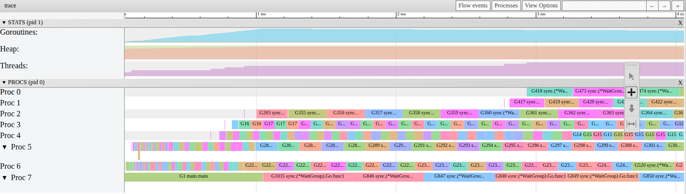
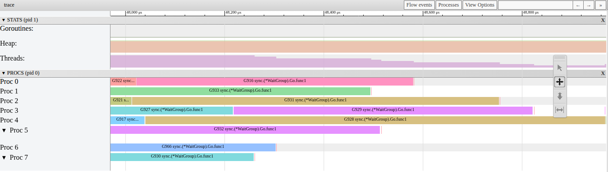

# P1-01. Шаг 1 не дотягивает до 8x: дело не в переключениях

**Сказано (10:42–11:35):** «Как мы помним из прошлой лекции, мы каждую горутину, когда мы ее добавляем на P, она попадает в runnext, дальше она попадает в кольцо, и из кольца они могут вытесняться уже в глобальную очередь. После этого какие-то у нас P, они всю свою работу сделают и будут уже брать либо из глобальной очереди, либо там воровать, ну, то, что мы детально рассматривали в прошлый раз. И получается, что вот чуть-чуть-чуть нашего спидапа, оно уходит именно на вот эти вот переключения, которые, ну, они неизбежны, потому что у нас... П ограничено в восьмью, да?»

**Как правильно:** дело не в переключениях: 1000 горутин на 1 P работают как обычный цикл
(1.01x). Теряем на краях: P включаются по одному, а в конце ждут хвост.

На практике я сказал, что P у нас всего 8 и что свободный P берет работу кражей. Это верно.
Именно так P и включаются в работу в начале шага. А вот вывод был неверный: ускорение
съедают не переключения.

## Переключения ничего не стоят

Как это проверить? Давайте запустим шаг 1 на одном P (`-cpu=1`). У нас 1000 горутин и всего
один P, то есть переключений максимум. Если бы они стоили заметного времени, шаг 1 был бы
медленнее шага 0, обычного цикла. А мы получаем 1.01x на экране в видео и 0.99–1.01x в 10
повторных замерах. То есть столько же, сколько цикл.

Значит, мы теряем где-то еще. Давайте посмотрим в трейс.

## Что видно в трейсе

Возьмем трейс шага 1 на 8 P и посмотрим первые 4 мс. Каждая строка это P. Засечка отмечает,
когда на нем началась первая задача.


Мы видим лестницу. P включаются по одному: 0.04, 0.07, 0.68, 0.77, 0.95, 2.75, 2.88 мс. А что с
восьмым P? Это P7, на нем работает main. До 0.99 мс он занят самим main: main создает 1000
горутин и только потом уходит ждать в `wg.Wait`.

В `go tool trace` (View trace by proc) это выглядит так. Обратите внимание на счетчик Threads
сверху: он растет такими же ступеньками.



Но лестница бывает разной длины. Этот трейс записан, когда машина перед запуском
простаивала. Если запустить тот же бинарник сразу после другого запуска, мы получаем вот что:
все разбуженные P работают уже через 0.41 мс. Дольше всех свободен P с main (0.94 мс).


Теперь второй край, конец шага. Задачи кончаются, и P по одному остаются без работы. В этом
трейсе первый P свободен уже за 0.71 мс до конца.




## Почему P включаются по одному

Давайте посмотрим, что делает `go` в цикле main
([proc.go#L5334-L5347](https://github.com/golang/go/blob/go1.27.1/src/runtime/proc.go#L5334-L5347)).
Новая горутина попадает в очередь нашего P, и runtime вызывает `wakep`:

```go
pp := getg().m.p.ptr()
runqput(pp, newg, true)

if mainStarted {
	wakep()
}
```

Зачем `wakep`? Чтобы разбудить еще один поток и отдать ему часть работы. Но будит он, только
если сейчас никто не ищет работу. Такой поток называется spinning
([proc.go#L3227-L3232](https://github.com/golang/go/blob/go1.27.1/src/runtime/proc.go#L3227-L3232)):

```go
// Be conservative about spinning threads, only start one if none exist
// already.
if sched.nmspinning.Load() != 0 || !sched.nmspinning.CompareAndSwap(0, 1) {
	return
}
```

Если spinning-потока нет, `wakep` берет свободный P и вызывает `startm`. `startm` будит
спящий M. Если спящих M нет, runtime создает новый (`newm`). Дальше отдает ему P и будит
([proc.go#L3087-L3088](https://github.com/golang/go/blob/go1.27.1/src/runtime/proc.go#L3087-L3088),
[#L3134-L3136](https://github.com/golang/go/blob/go1.27.1/src/runtime/proc.go#L3134-L3136)):

```go
nmp.spinning = spinning
nmp.nextp.set(pp)
notewakeup(&nmp.park)
```

Что делает разбуженный M? Его P пустой, поэтому он идет красть. Работа пока есть только в
очереди P с main, оттуда он и крадет
([proc.go#L3532-L3540](https://github.com/golang/go/blob/go1.27.1/src/runtime/proc.go#L3532-L3540)).
Пока он ищет, он spinning. Получается, все остальные вызовы `wakep` из цикла main сразу
возвращаются. Следующий поток разбудит только он сам, когда найдет работу
([proc.go#L4213-L4215](https://github.com/golang/go/blob/go1.27.1/src/runtime/proc.go#L4213-L4215),
[#L4036-L4050](https://github.com/golang/go/blob/go1.27.1/src/runtime/proc.go#L4036-L4050)):

```go
gp.m.spinning = false
nmspinning := sched.nmspinning.Add(-1)
...
wakep()
```

То есть у нас цепочка: каждый P включается только после того, как предыдущий нашел работу.
Это не баг, так задумано. Вот комментарий в начале файла
([proc.go#L79-L84](https://github.com/golang/go/blob/go1.27.1/src/runtime/proc.go#L79-L84)):

```go
// If there is at least one spinning thread (sched.nmspinning>1), we don't
// unpark new threads when submitting work. To compensate for that, if the last
// spinning thread finds work and stops spinning, it must unpark a new spinning
// thread. This approach smooths out unjustified spikes of thread unparking,
// but at the same time guarantees eventual maximal CPU parallelism
// utilization.
```

## Почему лестница то 0.4 мс, то 3 мс

Каждое звено цепочки это пробуждение потока операционной системой. Обычно звено занимает
порядка 0.05 мс, и 7 звеньев проходят за 0.3–0.5 мс.

А теперь самое интересное. На этой машине (WSL2) поток, который будят на CPU, простоявшем
20–50 мс и дольше, начинает работать примерно через 1 мс. Цепочка складывает эти задержки
одну за другой. Получается лестница в несколько миллисекунд (в замерах 2–11 мс).

Может, это Go? Нет. Та же цепочка из 7 потоков на C, без Go, на futex, без паузы
проходит за 0.43 мс (медиана). После простоя 50–100 мс за 7.3–7.8 мс.
И наоборот: если занять все CPU фоновой нагрузкой с `nice 19`, задержка пропадает. После
той же паузы лестница снова около 0.26 мс (медиана).

## Замер

i5-13600KF, WSL2, 20 логических CPU, go1.27.1, 9–10 октября 2026.

| Что | Значение |
|---|---|
| шаг 1 на `-cpu=1` | 1.01x (видео), 0.99–1.01x (10 повторов) |
| шаг 1 и шаг 5 на `-cpu=8` | 7.60–7.99x и 7.59–7.90x (10 повторов) |
| последний разбуженный P, запуски подряд | медиана 0.42 мс, 90% до 0.56 мс (100 трейсов) |
| последний разбуженный P, пауза 0.3 с перед запуском | 5.6–9.6 мс в 14 из 15 трейсов |
| P с main начинает задачи | 0.82–2.28 мс (100 трейсов) |
| хвост: P свободен до конца шага | до 0.4–0.7 мс |
| в среднем занято P за шаг, прогоны подряд в одном процессе | 7.83–7.87 из 8 (3 трейса) |

## Не проверено

Почему на WSL2 поток, разбуженный на простаивавшем CPU, стартует примерно через 1 мс. Внутри
Linux этого ожидания не видно: очередь планировщика пустая, steal 0. Значит, оно на стороне
Windows или Hyper-V. Чтобы назвать механизм, нужно смотреть со стороны Windows (ETW). На Linux
без виртуализации и на macOS не проверялось.

## Проверить самому

Откройте трейс из этого разбора. Из `week-01-scheduler/practice`:

```sh
go tool trace -http=127.0.0.1:6060 corrections/assets/p1-01-t1.out
```

Дальше View trace by proc и приблизьте первые 3 мс (клавиша W). Строки Proc начинаются по
одной.

А теперь свой трейс. Запишите два подряд и один после паузы:

```sh
bin/practice -step=1 -cpu=8 -trace=a.out; bin/practice -step=1 -cpu=8 -trace=b.out
sleep 1; bin/practice -step=1 -cpu=8 -trace=c.out
```

Сравните в `go tool trace`: когда начинает работать последний Proc в b.out и в c.out?
