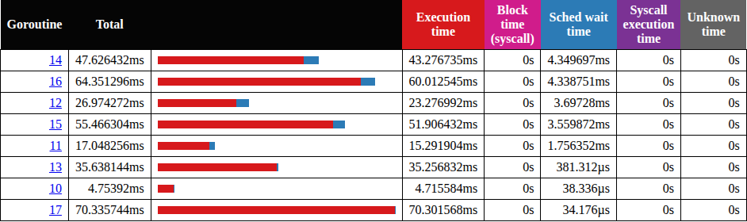
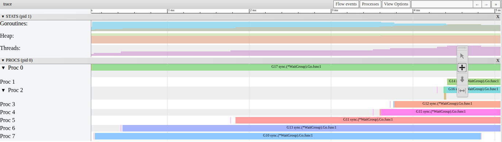

# P1-06. Sched wait в шаге 3: свободные P были

**Сказано (33:29–33:50):** «Почему это именно так? Да? У нас goroutine была готова к выполнению, но для нее не было свободного P. Если у нас 8 их было, да? Выполнялись.»

**Как правильно:** свободные P были: в начале P включаются по одному, как в шаге 1.

На практике я верно прочитал колонку: Sched wait это время, когда горутина готова к
выполнению, но не работает. И верно заметил, что main почти не исполнялся: он ждал в
`wg.Wait`. А вот причина другая. Все 8 P не были заняты. В начале шага часть P еще не
включилась.

## Что видно в Goroutine analysis

Откройте трейс шага 3, Goroutine analysis, группа `sync.(*WaitGroup).Go.func1`. Это наши 8
воркеров. Отсортируем по колонке Sched wait time.



Мы видим, что у пяти воркеров ожидание от 1.76 до 4.35 мс. А у G10 и G17 всего 0.04 и 0.03 мс. Откуда такая
разница?

Сначала давайте посмотрим, когда они ждали. Воркеров вытесняли 15 раз, но после вытеснения
горутина снова работает через 0.001–0.03 мс. То есть почти все ожидание приходится на старт:
от создания горутины до ее первого запуска.

## Что видно в трейсе

Возьмем первые 5 мс шага. Каждая строка это P. Засечка отмечает, когда на нем началась
первая задача.


Мы видим лестницу, как в шаге 1. P0 начинает сразу, через 0.01 мс. Остальные включаются по
одному: 0.05, 0.39, 1.77, 3.54, 3.70, 4.34, 4.35 мс. Что в это время с горутинами? На отметке
1 мс работают 3, еще 5 готовы, и 5 P свободны. То есть свободные P были.

В `go tool trace` (View trace by proc) это выглядит так:



Почему в шаге 3 это видно прямо в Sched wait? У нас 8 горутин на 8 P, и каждая работает долго,
от 4.7 до 70 мс. Занятый P другую горутину не возьмет: его горутина работает, а вытеснить ее могут не раньше
чем через 10 мс. Получается, каждая
горутина ждет, пока включится ее собственный P. Ее Sched wait и есть место этого P на лестнице.
В шаге 1 та же лестница размазана по 1000 коротким задачам, и в одной горутине ее не видно.

## Чем шаг 3 отличается от шага 1

P включаются той же цепочкой: каждый следующий P будит тот, который только что нашел работу.
Механизм с кодом разобран в [P1-01](P1-01.md#почему-p-включаются-по-одному).

Одно отличие есть, и это P с main. В шаге 1 он занят 0.8–2.3 мс: main создает 1000
горутин. А здесь main создает 8 горутин за 0.002 мс и сразу уходит в `wg.Wait`. Его P берет
последнюю созданную горутину. Почему последнюю? Новая горутина попадает в runnext, а runnext
P берет первым
([proc.go#L7649-L7657](https://github.com/golang/go/blob/go1.27.1/src/runtime/proc.go#L7649-L7657)):

```go
func runqget(pp *p) (gp *g, inheritTime bool) {
	// If there's a runnext, it's the next G to run.
	next := pp.runnext
	// If the runnext is non-0 and the CAS fails, it could only have been stolen by another P,
	// because other Ps can race to set runnext to 0, but only the current P can set it to non-0.
	// Hence, there's no need to retry this CAS if it fails.
	if next != 0 && pp.runnext.cas(next, 0) {
		return next.ptr(), true
	}
```

Это G17, поэтому у нее Sched wait всего 0.03 мс. А G10 взял первый разбуженный P. Остальные
шесть ждали, пока проснутся их P.

## Почему лестница здесь 4.35 мс

В [P1-01](P1-01.md#почему-лестница-то-04-мс-то-3-мс) мы видели: на этой машине (WSL2) поток,
который будят на CPU, простоявшем 20–50 мс и дольше, начинает работать примерно через 1 мс.
Цепочка складывает эти задержки одну за другой.

Живой трейс записан на практике, после объяснения. То есть машина перед запуском
простаивала. Если запустить шаг 3 после паузы 0.3 с, последний P включается через 6.0 мс
(медиана). 4.35 мс попадают в этот разброс. А если запустить шаг 3 сразу после шага 1, мы
получаем 0.47 мс:


А теперь самое интересное. Шаг 3 сразу после шага 3 тоже медленный: медиана 0.85 мс, и в 44
из 100 запусков дольше 1 мс. Почему? Давайте посмотрим на конец шага 3. Чанки кончаются по одному, и
последние 22 мс работают не больше 3 P из 8. Остальные CPU простаивают. Получается, шаг 3 сам
готовит следующему запуску простоявшие CPU. Шаг 1 так не делает: он держит все 8 P занятыми
почти до конца.

Может, это GC? Нет. Ни в одном из этих трейсов нет сборки мусора, и с `GOGC=off` медиана почти та же
(5.75 мс). А если в уже работающем процессе занять все CPU фоновой нагрузкой с `nice 19`,
задержка пропадает: после паузы 100 мс лестница 0.26 мс вместо 5.49 мс (медиана).

## Замер

i5-13600KF, WSL2, 20 логических CPU, go1.27.1, 9–10 октября 2026. Последний разбуженный P:
когда на нем запускается первая горутина, от начала шага.

| Что | Значение |
|---|---|
| живой трейс, Sched wait воркеров | G11 1.76, G12 3.70, G14 4.35, G15 3.56, G16 4.34 мс |
| живой трейс, ожидание после вытеснения | 0.001–0.03 мс (15 вытеснений) |
| живой трейс, P с main берет G17 | через 0.002 мс после создания |
| шаг 1, P с main начинает задачи | 0.82–2.28 мс (100 трейсов, P1-01) |
| шаг 3 после паузы 0.3 с (100 трейсов) | медиана 6.0 мс, 0.88–13.1 мс |
| то же с `GOGC=off` (100 трейсов) | медиана 5.75 мс, 0.40–13.9 мс |
| шаг 3 сразу после шага 1 (100 трейсов) | медиана 0.45 мс, 90% до 0.63 мс |
| шаг 3 сразу после шага 3 (100 трейсов) | медиана 0.85 мс, 44 из 100 дольше 1 мс |
| уже работающий процесс, пауза 100 мс (30 трейсов) | медиана 5.49 мс; с фоновой нагрузкой 0.26 мс |

## Не проверено

Почему на WSL2 поток, разбуженный на простаивавшем CPU, стартует примерно через 1 мс. Это
тот же открытый вопрос, что в [P1-01](P1-01.md#не-проверено). На Linux без виртуализации и на
macOS не проверялось.

## Проверить самому

Откройте трейс из этого разбора. Из `week-01-scheduler/practice`:

```sh
go tool trace -http=127.0.0.1:6060 corrections/assets/p1-06-live-step3.out
```

Дальше Goroutine analysis, `sync.(*WaitGroup).Go.func1`, колонка Sched wait time. Потом View
trace by proc: строки Proc в начале шага включаются по одной.

А теперь свои трейсы. Запишите шаг 3 сразу после шага 1 и после паузы:

```sh
bin/practice -step=1 -cpu=8; bin/practice -step=3 -cpu=8 -trace=a.out
sleep 1; bin/practice -step=3 -cpu=8 -trace=b.out
```

Сравните колонку Sched wait time в a.out и b.out.
