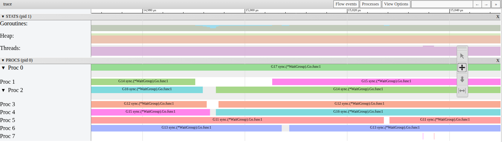

# P1-07. Глобальная очередь используется: вытесненная G уходит в нее

**Сказано (36:44–36:50):** «А глобальной очереди не будет, потому что у нас количество cpu такое же, как количество горутин запущенных.»

**Как правильно:** глобальная очередь используется: вытесненная G уходит в нее. В этом
трейсе так было 15 раз.

На практике я верно сказал про старт. Новая горутина попадает в локальную очередь того P,
который ее создал, а не в глобальную
([proc.go#L5341](https://github.com/golang/go/blob/go1.27.1/src/runtime/proc.go#L5341)).
У нас 8 горутин на 8 P, и при создании ни одна в глобальную очередь не идет. Но в шаге 3
горутины работают долго, и их вытесняют. А вытесненная горутина идет как раз в глобальную
очередь.

## Что видно в трейсе

Возьмем живой трейс шага 3, весь шаг. Каждая строка это P. Треугольник отмечает, где
горутину вытеснили.


Мы видим 15 вытеснений. Они идут группами: около 10, 15, 30 и 50 мс. После вытеснения
горутина снова работает, иногда на том же P, иногда на другом. Например, G14 работала на P1,
а после 15 мс продолжает на P2.

Давайте приблизим момент около 15 мс. В `go tool trace` (View trace by proc) это выглядит так:



G14 переходит с Proc 1 на Proc 2, G16 с Proc 2 на Proc 4, G15 с Proc 4 на Proc 1. G12, G11 и
G13 продолжают на своих P. Пауза между двумя отрезками работы одной горутины несколько микросекунд.

Самой очереди в трейсе нет. Мы видим только, что горутина перестала работать с причиной
`preempted` и потом снова работает. Где она была между этими моментами? Давайте посмотрим
в код runtime.

## Почему: код runtime

Горутину в шаге 3 вытесняет sysmon. Когда именно, разобрано в плашке [P1-09](P1-09.md). Здесь нам
важно, что дальше. sysmon посылает потоку сигнал. Обработчик сигнала заставляет горутину
вызвать `asyncPreempt`, а тот вызывает `asyncPreempt2`
([preempt.go#L327-L331](https://github.com/golang/go/blob/go1.27.1/src/runtime/preempt.go#L327-L331)):

```go
		if gp.preemptStop {
			preemptPark(gp)
		} else {
			gopreempt_m(gp)
		}
```

`preemptStop` ставит runtime, когда горутину нужно остановить на месте, например чтобы GC
просканировал ее стек. У нас обычное вытеснение, поэтому идем в `gopreempt_m`
([proc.go#L4376-L4377](https://github.com/golang/go/blob/go1.27.1/src/runtime/proc.go#L4376-L4377)):

```go
func gopreempt_m(gp *g) {
	goschedImpl(gp, true)
```

Это тот же `Gosched`, только с флагом `preempted`. Дальше `goschedImpl` решает, куда положить
горутину
([proc.go#L4346-L4354](https://github.com/golang/go/blob/go1.27.1/src/runtime/proc.go#L4346-L4354)):

```go
	if preempted && sched.gcwaiting.Load() {
		// If preempted for STW, keep the G on the local P in runnext
		// so it can keep running immediately after the STW.
		runqput(pp, gp, true)
	} else {
		lock(&sched.lock)
		globrunqput(gp)
		unlock(&sched.lock)
	}
```

То есть в локальную очередь горутина попадает, только если runtime останавливает мир
(stop-the-world), например для GC. Иначе она идет в глобальную очередь. Потом `goschedImpl`
будит еще один P (`wakep`,
[proc.go#L4356-L4357](https://github.com/golang/go/blob/go1.27.1/src/runtime/proc.go#L4356-L4357))
и вызывает `schedule`. Получается, вытесненную горутину может взять любой P: и прежний, и
разбуженный. Почему в трейсе бывает и так, и так, разобрано в плашке P1-17.

Какая ветка была у нас? В живом трейсе нет ни одной сборки мусора, и в 120 новых трейсах
шага 3 тоже. Получается, `sched.gcwaiting` false, и все 15 горутин ушли в глобальную очередь.

## Сигнал или проверка стека

Когда sysmon решает вытеснить горутину, он делает две вещи сразу
([proc.go#L6937-L6943](https://github.com/golang/go/blob/go1.27.1/src/runtime/proc.go#L6937-L6943)):

```go
	gp.stackguard0 = stackPreempt

	// Request an async preemption of this P.
	if preemptMSupported && debug.asyncpreemptoff == 0 {
		pp.preempt = true
		preemptM(mp)
	}
```

Первая строка ставит горутине флаг. В начале почти каждой функции есть проверка: хватает ли
стека. Флаг делает так, что эта проверка не проходит. Горутина попадает в `newstack`, а там
тот же `gopreempt_m`
([stack.go#L1173-L1174](https://github.com/golang/go/blob/go1.27.1/src/runtime/stack.go#L1173-L1174)):

```go
		// Act like goroutine called runtime.Gosched.
		gopreempt_m(gp) // never return
```

То есть по флагу горутина останавливается не сразу, а на следующем вызове функции. Вторая
часть, `preemptM`, это сигнал, который мы разобрали выше. Он останавливает горутину где угодно,
даже в цикле без вызовов. Какой путь сработает, решает то, что случится раньше.

Какой путь был у нас? Трейс хранит стек каждого вытеснения. У всех 15 он начинается с
`runtime.asyncPreempt2`, а ниже `work.Spin`. Давайте посмотрим, что делает Spin
([work.go#L23-L27](../work/work.go#L23-L27)):

```go
	for range units * unitIters {
		x ^= x << 13
		x ^= x >> 7
		x ^= x << 17
	}
```

Внутри цикла нет ни одного вызова функции. Значит, нет и проверки стека, и флаг здесь не
сработает. Остановить Spin посреди цикла может только сигнал.

А что, если мы выключим сигнал (`GODEBUG=asyncpreemptoff=1`)? Тогда остается только флаг.
Посмотрим на воркер шага 3
([run.go#L18-L22](../step3-chunked/run.go#L18-L22)):

```go
		wg.Go(func() {
			for _, t := range tasks[lo:hi] {
				t()
			}
		})
```

Здесь важна строка `t()`. Это вызов функции, и он происходит на каждую задачу. Задача
короткая: в живом трейсе от 0.001 до 0.83 мс. Получается, горутина доходит до следующего
`t()` меньше чем за 1 мс. В начале вызова срабатывает проверка стека, и горутину вытесняют.
Вытеснений столько же, 12–19 на трейс, и отрезки работы почти той же длины. И в глобальную
очередь горутина попадает так же: оба пути ведут в `gopreempt_m`.

## Можно ли увидеть саму очередь

Трейс очередь не показывает. Как тогда мы убедимся, что горутина была именно там? Есть два
способа.

Первый: `GODEBUG=schedtrace=1`. Раз в 1 мс runtime печатает строку состояния, и в ней
`runqueue=` это длина глобальной очереди. Печатает ее sysmon, сразу после того как
проверил P и вытеснил горутину
([proc.go#L6648](https://github.com/golang/go/blob/go1.27.1/src/runtime/proc.go#L6648),
[proc.go#L6662-L6664](https://github.com/golang/go/blob/go1.27.1/src/runtime/proc.go#L6662-L6664)).
Горутина лежит в очереди несколько микросекунд, поэтому попадаем не всегда. В 30 запусках
шага 3 `runqueue=1` было в 36 строках из 461, при этом локальные очереди всех P пустые.

Второй: отладчик. Под Delve можно поставить точку на `runtime.globrunqput` и посчитать вызовы за один
запуск шага 3. Пока пишется трейс, вызовов 59, и все из `goschedImpl` после `asyncPreempt2`. В трейсе того же
запуска 59 вытеснений. То есть одно вытеснение, один `globrunqput`. Под отладчиком шаг идет
медленнее, поэтому вытеснений больше, чем 15. Здесь важен только счет.

## Почему 15

Почему у нас именно 15? Это число для живого трейса. В 120 новых запусках шага 3 вытеснений от 13 до 18, чаще
всего 16. Сколько их будет, зависит от того, сколько отрезков по 10–20 мс помещается в
чанки. Почему отрезок от 10 до 20 мс, разобрано в плашке [P1-09](P1-09.md).

## Замер

i5-13600KF, WSL2, 20 логических CPU, go1.27.1, 10 октября 2026. Шаг 3, `-cpu=8`, бинарь из
`practice`, пауза 0.3 с перед каждым запуском.

| Что | Значение |
|---|---|
| живой трейс: вытеснений | 15, все через `asyncPreempt2`, сборок мусора 0 |
| живой трейс: после вытеснения | на другом P 10, на том же 5; пауза 0.001–0.028 мс, медиана 0.003 мс |
| 120 новых трейсов: вытеснений на трейс | 13–18, медиана 16; ровно 15 в 34 трейсах |
| 120 новых трейсов: путь | 1874 через сигнал, 23 через проверку стека; сборок мусора 0 |
| 100 трейсов с `GODEBUG=asyncpreemptoff=1` | 12–19, медиана 16, все через проверку стека |
| `GODEBUG=schedtrace=1`, 30 запусков | `runqueue=1` в 36 строках из 461 |
| Delve, точка на `runtime.globrunqput`, 1 запуск | 59 вызовов из `goschedImpl`, 59 вытеснений в трейсе |

## Проверить самому

Откройте живой трейс из [P1-06](P1-06.md). Из `week-01-scheduler/practice`:

```sh
go tool trace -http=127.0.0.1:6060 corrections/assets/p1-06-live-step3.out
```

Дальше View trace by proc, около 15 мс от начала трейса. Горутины G14, G15 и G16 меняют P.

Стек каждого вытеснения можно увидеть так:

```sh
go tool trace -d=parsed corrections/assets/p1-06-live-step3.out | grep -A2 'Reason="preempted"'
```

А глобальную очередь в своем запуске так:

```sh
GODEBUG=schedtrace=1 bin/practice -step=3 -cpu=8 -trace=x.out 2>&1 | grep 'runqueue=[1-9]'
```

Запустите несколько раз: строка с `runqueue=1` появляется не в каждом запуске.
