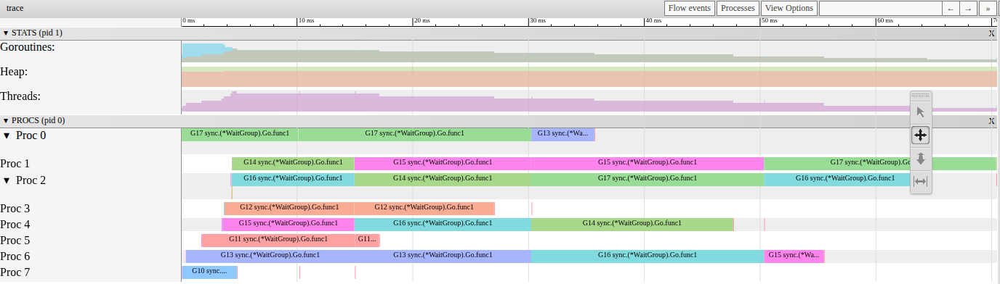

# P1-09. Вытеснение: не меньше 10 мс, а на деле от 10 до 20

**Сказано (38:00–38:10):** «То есть, чтобы вот эту задачу вытеснить. И дать поработать другой задаче. Должно пройти, типа, не менее 10 миллисекунд, получается.»

**Как правильно:** «не меньше 10 мс» верно, а на деле 10–20 мс: sysmon проверяет P раз в 10 мс и
считает 10 мс от проверки, где впервые увидел G.

На практике я сказал, что до вытеснения должно пройти не менее 10 мс. И проверил на трейсе: первый
отрезок G17 кончается около 10 мс. Это верно. Но на том же экране следующие отрезки G17 длиннее,
около 20 мс. Откуда они?

## Что видно в трейсе

Возьмем живой трейс шага 3, весь шаг. Каждая строка это P. Треугольник отмечает вытеснение, а число
перед ним длину отрезка: сколько горутина проработала до этого вытеснения.


Мы видим 15 отрезков, от 10.04 до 20.11 мс. Они складываются в три группы: около 10–15 мс, около
15 мс и около 20 мс. У G17 два вида: сначала 10.04, потом 20.10 и 20.11 мс.

И еще одно. Вытеснения на разных P стоят на одной вертикали: 14.92, 30.18 и 50.29 мс от начала
шага. Только в 10.05 мс вытеснена одна G17. Получается, мы видим в основном не одиночные
вытеснения, а пачки, в одни и те же моменты. Кто решает, когда?

В `go tool trace` (View trace by proc) тот же шаг выглядит так:



## Кто считает 10 мс

Вытесняет горутину sysmon. Это отдельный поток runtime без P. Он просыпается, проверяет все P и
снова засыпает. Давайте посмотрим, сколько он спит
([proc.go#L6549-L6557](https://github.com/golang/go/blob/go1.27.1/src/runtime/proc.go#L6549-L6557)):

```go
		if idle == 0 { // start with 20us sleep...
			delay = 20
		} else if idle > 50 { // start doubling the sleep after 1ms...
			delay *= 2
		}
		if delay > 10*1000 { // up to 10ms
			delay = 10 * 1000
		}
		usleep(delay)
```

`idle` считает проходы подряд, в которых sysmon ничего полезного не сделал. Сначала он спит по
20 мкс. После 50 пустых проходов пауза удваивается на каждом проходе: 40, 80, 160 мкс и так далее.
На 10 мс она останавливается.

А вытеснение считается полезным делом? Нет
([proc.go#L6648-L6652](https://github.com/golang/go/blob/go1.27.1/src/runtime/proc.go#L6648-L6652)):

```go
		if retake(now) != 0 {
			idle = 0
		} else {
			idle++
		}
```

`retake` возвращает, сколько P он забрал у системных вызовов
([proc.go#L6763](https://github.com/golang/go/blob/go1.27.1/src/runtime/proc.go#L6763)). Вытеснение
этот счетчик не трогает. Забрать P sysmon может только у горутины, которая вошла в системный вызов через
`entersyscall`. Наши воркеры так не делают. Короткие системные вызовы в шаге есть: сигнал вытеснения,
пробуждение и усыпление потоков. Но P у них не отнять. А через `entersyscall` в трейсе шага ходит
только запись трейса, и в 12 запусках из 12 пауза sysmon посреди шага не сбрасывалась. То есть каждый
проход для sysmon пустой, и скоро он спит по 10 мс. Отсюда «раз в 10 мс» в плашке.

## Когда sysmon вытесняет

Теперь главное. Как sysmon узнает, что горутина работает 10 мс? Давайте посмотрим в `retake`
([proc.go#L6707-L6716](https://github.com/golang/go/blob/go1.27.1/src/runtime/proc.go#L6707-L6716)):

```go
		// Preempt G if it's running on the same schedtick for
		// too long. This could be from a single long-running
		// goroutine or a sequence of goroutines run via
		// runnext, which share a single schedtick time slice.
		schedt := int64(pp.schedtick)
		if int64(pd.schedtick) != schedt {
			pd.schedtick = uint32(schedt)
			pd.schedwhen = now
		} else if pd.schedwhen+forcePreemptNS <= now {
			preemptone(pp)
```

`schedtick` это счетчик на P. Он растет каждый раз, когда P запускает горутину с новым отрезком
времени: новую или продолженную после вытеснения
([proc.go#L3364-L3366](https://github.com/golang/go/blob/go1.27.1/src/runtime/proc.go#L3364-L3366)).
Исключение, горутина из runnext, разобрано ниже. sysmon помнит значение с прошлой проверки. Если
счетчик сдвинулся, значит, с прошлого раза на P начался новый отрезок. Тогда sysmon записывает текущее время в `schedwhen`. Больше он ничего не
делает. Если счетчик тот же, а с `schedwhen` прошло 10 мс (`forcePreemptNS`), sysmon вытесняет.

Получается, sysmon не знает, когда горутина начала работать. Он знает только, когда сам ее впервые
увидел. Наш воркер за весь чанк ни разу не уходит с P: он просто вызывает задачи одну за другой
(цикл показан в [P1-07](P1-07.md#сигнал-или-проверка-стека)). Значит, счетчик у нас стоит, пока sysmon
сам горутину не вытеснит. Что происходит дальше, сигнал и глобальная очередь, тоже разобрано в
[P1-07](P1-07.md).

## Откуда от 10 до 20

Давайте пройдем по шагам. Пусть у нас sysmon проверяет P раз в 10 мс.

1. Горутина начинает работать.
2. Через 0–10 мс приходит проверка. sysmon видит ее впервые и записывает время.
3. Через 10 мс приходит следующая проверка. 10 мс от записи прошли: sysmon вытесняет.

То есть отрезок это 10 мс плюс время от старта горутины до первой проверки. Если горутина начала
прямо перед проверкой, отрезок чуть больше 10 мс. Если сразу после, почти 20.

А что после вытеснения? Горутина снова работает уже через несколько микросекунд. То есть она
стартует сразу после проверки. Ее заметит только
следующая проверка, через 10 мс, а вытеснит еще через 10. Получается, каждый следующий отрезок
около 20 мс. Так у G17: 20.10 и 20.11 мс.

Почему мы видим 20.1, а не ровно 20? Пауза sysmon чуть длиннее заказанной: в замерах на этой машине между
проверками 10.07–10.26 мс.

## Откуда 15 мс

А теперь самое интересное. У нас в трейсе четыре отрезка по 15.25–15.26 мс. Откуда они, если
проверки идут раз в 10 мс?

Дело в начале шага. В новых запусках видно, что перед самым шагом sysmon спит глубоким сном. А
проснувшись так, он начинает паузу заново с 20 мкс
([proc.go#L6601-L6604](https://github.com/golang/go/blob/go1.27.1/src/runtime/proc.go#L6601-L6604)):

```go
				if syscallWake {
					idle = 0
					delay = 20
				}
```

Дальше пауза растет: 20, 40, …, 2560, 5120 мкс, и только потом 10 мс. Это видно по системным
вызовам потока sysmon: в 12 запусках из 12 паузы шли ровно в таком порядке. В 50 других запусках
sysmon впервые уснул на 10 мс через 14.8–31 мс после начала шага. То есть в начале шага, до 31 мс,
sysmon проверяет P чаще и неровно.

Давайте посмотрим на живой трейс. В 14.92 мс sysmon вытеснил шесть горутин, и они сразу
продолжили. Четыре из них проработали до следующего вытеснения в 30.18 мс. Самих проверок между
этими моментами в трейсе не видно. Но если sysmon в это время спал по 5120 мкс, следующая проверка
пришла примерно через 5 мс. Она горутины заметила, а вытеснила через 10 мс. Получается 5 + 10, то
есть около 15 мс: наши 15.25 мс.

Вот запуск, где мы видим каждую проверку sysmon (пунктир). В начале шага пунктир густой, с 25 мс
проверки идут раз в 10 мс:


Пунктира в самом трейсе нет: sysmon работает без P и событий в трейс не пишет. Моменты проверок
записаны снаружи, по переключениям потока sysmon. Сам трейс этого запуска лежит рядом:
[p1-09-fresh-sysmon.out](assets/p1-09-fresh-sysmon.out).

## А бывает меньше 10 мс?

Бывает, у одной горутины на шаг. Main создает воркеров в цикле. Последний созданный лежит в
runnext у P с main. Когда main уходит ждать в `wg.Wait`, этот P берет его первым (разобрано в
[P1-06](P1-06.md#чем-шаг-3-отличается-от-шага-1)). Такая горутина продолжает отрезок времени main:
счетчик `schedtick` не растет. Об этом и говорит комментарий в `retake` выше: горутины из runnext
делят один отрезок.

То есть sysmon считает 10 мс не от старта этой горутины, а от того, когда впервые увидел main. В
120 новых трейсах у такой горутины первый отрезок от 9.60 до 18.67 мс, медиана 10.01 мс. Меньше
10 мс он в 56 трейсах из 120. У нас в живом трейсе это G17: 10.04 мс.

## Бывает больше 20 мс?

Бывает, но ненамного. Мы помним, что между проверками sysmon чуть больше 10 мс, до 10.26. Два таких
периода дают до 20.52 мс. В 120 новых трейсах отрезки, которые начались позже 15 мс от начала шага, не
длиннее 20.54 мс. Три самых длинных из них, по 20.54 мс, начались в 15.46 мс, когда sysmon еще
разгонялся.

Заметно длиннее бывает только в начале шага, пока sysmon проверяет P неровно. Из 38 отрезков
длиннее 20.3 мс 28 начались в первые 15 мс шага, они от 20.32 до 22.85 мс. А все 10 отрезков длиннее
21 мс начались именно там. Если же перед шагом дать sysmon разогнаться (тот же шаг в уже
работающем процессе), из 407 отрезков длиннее 20.3 мс только один.

## Замер

i5-13600KF, WSL2, 20 логических CPU, go1.27.1, 10 октября 2026. Шаг 3, `-cpu=8`, бинарь из
`practice`, пауза 0.3 с перед каждым запуском.

| Что | Значение |
|---|---|
| живой трейс: отрезки до вытеснения | 15, от 10.04 до 20.11 мс; G17: 10.04, 20.10, 20.11 |
| живой трейс: моменты вытеснения | 10.05, 14.92, 30.18, 50.29 мс от начала шага |
| 120 новых трейсов (те же, что в [P1-07](P1-07.md)) | 1897 отрезков, медиана 15.31 мс; 95.0% от 10.00 до 20.30 мс |
| из них короче 10 мс | 56, все у горутины из runnext |
| из них начались позже 15 мс от начала шага | не длиннее 20.54 мс |
| из них длиннее 20.3 мс | 38: 28 начались в первые 15 мс (20.32–22.85 мс), 10 позже (20.30–20.54 мс); все 10 длиннее 21 мс начались в первые 15 мс |
| пауза sysmon впервые 10 мс (50 запусков) | через 14.8–31.4 мс от начала шага |
| между проверками sysmon после этого | 10.07–10.26 мс |
| шаг 3 на `-cpu=1` (10 запусков), отрезки после первого | 141, медиана 20.11 мс, p10–p90 20.08–20.18 мс |
| уже работающий процесс (30 запусков, 407 отрезков) | длиннее 20.3 мс: 1; продолженные отрезки 20.07–20.21 мс (p10–p90) |

Длины отрезков мы видим прямо в трейсах. Моменты проверок sysmon видны в трейсе только когда кого-то
вытеснили. Поэтому каждая проверка записана снаружи: по системным вызовам и переключениям потока
sysmon, без остановки процесса.

## Не проверено

- Что усыпляет sysmon глубоким сном перед шагом. Скорее всего, это остановка мира в
  `runtime.GOMAXPROCS` прямо перед записью трейса, но это вывод, а не наблюдение.
- Почему в начале шага короткий сон sysmon (20 мкс) иногда длится несколько миллисекунд. Та же пауза
  на C, без Go, так затягивается намного реже. Возможная причина та же, что в
  [P1-01](P1-01.md#не-проверено): пробуждение простаивавшего CPU на WSL2. Не проверялось.
- На Linux без виртуализации и на macOS не проверялось.

## Проверить самому

Откройте живой трейс из [P1-06](P1-06.md). Из `week-01-scheduler/practice`:

```sh
go tool trace -http=127.0.0.1:6060 corrections/assets/p1-06-live-step3.out
```

Дальше View trace by proc. Кликните по отрезкам G17: два на Proc 0 и следующий на Proc 2. Wall
Duration 10.04, 20.10 и 20.11 мс.

Длину каждого отрезка до вытеснения печатает такая команда:

```sh
go tool trace -d=parsed corrections/assets/p1-06-live-step3.out | awk '/StateTransition/ && /GoID=/ { match($0,/Time=[0-9]+/); t=substr($0,RSTART+5,RLENGTH-5); match($0,/GoID=[0-9]+/); g=substr($0,RSTART+5,RLENGTH-5); p=substr($2,3); if (/Runnable->Running/) { if (g in pre) { printf "G%s %.2f ms on P%s, then P%s after %.3f ms\n", g, len[g], pp[g], p, (t-pre[g])/1e6; delete pre[g] } st[g]=t } if (/Running->Runnable/ && /preempted/) { len[g]=(t-st[g])/1e6; pp[g]=p; pre[g]=t } }'
```

Она печатает 15 строк, первая: `G17 10.04 ms on P0, then P0 after 0.028 ms`.

А теперь контраст. На одном P у шага 3 один воркер, и после первого отрезка он все время
продолжает сразу после проверки sysmon:

```sh
bin/practice -step=3 -cpu=1 -trace=y.out
```

Прогоните ту же команду по y.out. Что мы ожидаем? Первый отрезок от 10 до 20 мс, все следующие около
20. В 10 таких запусках у 141 следующего отрезка медиана 20.11 мс, 80% от 20.08 до 20.18 мс.
Несколько отрезков около 15 мс бывают в начале шага, пока sysmon разгоняется.
