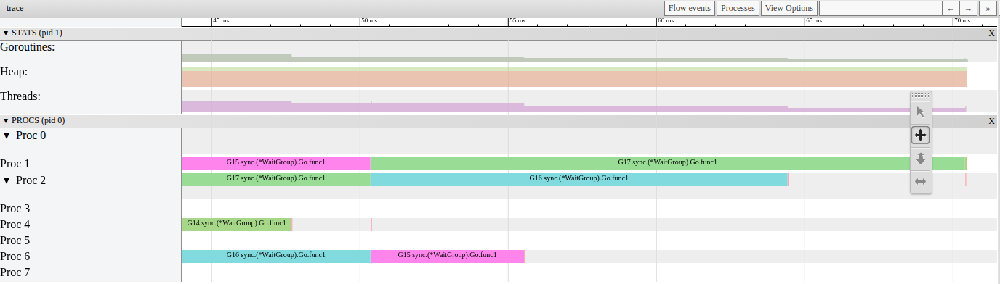
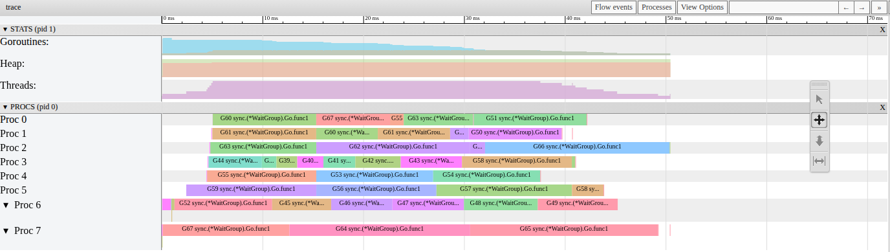

# P1-10. В шаге 3 P простаивают, потому что чанки кончаются по одному

**Сказано (42:56–43:12):** «Но я, в общем, разберу это, и подробнее обязательно поясню в этой ситуации, Почему у нас остальные эти простаивают? Вот, потому что прошло... надо было сейчас объяснить, но готового объяснения у меня нет.»

**Как правильно:** чанк кончился, его горутина завершилась, горутин стало меньше, чем P.
Работающую G украсть нельзя; вытеснение лишь переносит ее на другой P. Больше чанков,
меньше простоя: при n=32 уже 6.3–6.9x.

На практике две вещи прозвучали верно. Когда на экране было 1.33x на `-cpu=2`, я напомнил,
что задачи растут по сложности: первая самая легкая, тысячная самая долгая. А из зала
спросили, пропадет ли проблема при большем n, и сразу предположили: «будет больше, что
красть». Я согласился: P столько же, а n больше, «будет больше чего красть». Это и есть
решение. А почему простаивают остальные P, я на практике не объяснил. Здесь объяснение.

## Сначала прикинем

Какое ускорение мы ждем от шага 3? Давайте посмотрим, как он делит работу
([run.go#L17-L22](../step3-chunked/run.go#L17-L22)):

```go
		lo, hi := w*len(tasks)/n, (w+1)*len(tasks)/n
		wg.Go(func() {
			for _, t := range tasks[lo:hi] {
				t()
			}
		})
```

У нас n воркеров, и каждый получает свой чанк: задачи от `lo` до `hi` подряд. Чанки
делятся заранее, до первой задачи. Воркер доделал свой чанк, и его горутина завершается.
Новой работы ей никто не дает.

Сколько стоит чанк? Задача i стоит i+1 единиц
([work.go#L53-L54](../work/work.go#L53-L54)):

```go
		case "skewed":
			units = i + 1
```

То есть 1000 задач стоят 500500 единиц, и чем дальше задача, тем она дороже.

Возьмем n=2, как на `-cpu=2`. Первый чанк это задачи 0–499, 125250 единиц. Второй это
задачи 500–999, 375250 единиц. То есть во втором чанке примерно 3/4 всей работы. Шаг не
кончится, пока его не доделают. Получается, больше 500500 / 375250 = 1.33x мы не получим. И на
экране было 1.33x.

А шаг 2 на том же `-cpu=2` дает 2.00x. Там задачи раздаются по одной, и оба P работают до
конца. Отсюда плашка P1-04: «1.33x против 2.00x: это в 1.5 раза медленнее, а не почти в 2.»

Теперь возьмем n=8, как у нас на `-cpu=8`. Чанки стоят 7875, 23500, 39125 и так далее
до 117250 единиц, примерно как 1 : 3 : 5 : … : 15. В последнем 0.2343 всей работы, поэтому предел 4.27x. На экране 4.25x. Одна единица
стоит примерно 0.6 мкс (плашка P1-03). Значит, последний чанк идет около 70 мс, и шаг 3 на
экране длился 70.1 мс.

Получается, шаг 3 упирается в свой самый большой чанк. Давайте посмотрим, что в это время
делают остальные P.

## Что видно в трейсе

Возьмем живой трейс шага 3, весь шаг. Каждая строка это P. Закрашено время, когда P
свободен и задач для него не осталось.


Мы видим лестницу наоборот. G10 с самым маленьким чанком завершается через 4.76 мс. Дальше
горутины завершаются по одной: 17.06, 26.98, 35.65, 47.63, 55.47 и 64.36 мс. Последней
заканчивает G17, через 70.34 мс.

А что в это время в очередях? С 5 мс до конца шага готовых к запуску горутин нет. Есть одно
исключение: вытесненная горутина ждет в очереди от 1 до 28 мкс, и мы вернемся к нему ниже. То
есть каждая завершенная горутина освобождает свой P насовсем. У нас работают 7 горутин, потом 6, и
так до одной. Давайте сложим время простоя всех P: получается 240 мс. А всего у 8 P было
8 × 70.35 = 563 мс. То есть P простаивали 42.7% времени.

В `go tool trace` (View trace by proc) конец шага выглядит так. Строки Proc пустеют по одной, а
счетчик Goroutines сверху опускается ступеньками.



Почему свободный P не возьмет часть работы у G17? Ведь у нее еще десятки миллисекунд задач.

## Почему свободный P не может помочь

Свободный P ищет работу и пробует украсть ее у других P. Как разбуженный P идет красть, мы
видели в [P1-01](P1-01.md#почему-p-включаются-по-одному). Давайте посмотрим, что именно он может взять
([proc.go#L7713-L7719](https://github.com/golang/go/blob/go1.27.1/src/runtime/proc.go#L7713-L7719)):

```go
func runqgrab(pp *p, batch *[256]guintptr, batchHead uint32, stealRunNextG bool) uint32 {
	for {
		h := atomic.LoadAcq(&pp.runqhead) // load-acquire, synchronize with other consumers
		t := atomic.LoadAcq(&pp.runqtail) // load-acquire, synchronize with the producer
		n := t - h
		n = n - n/2
		if n == 0 {
```

`pp` это P, у которого крадут. `h` и `t` это начало и конец его локальной очереди. `n` это
сколько горутин в ней лежит. Вор забирает половину. Если очередь пустая, остается только
runnext. Его вор пробует взять только на последнем из четырех проходов по чужим P (эту ветку
разбирает [P1-12](P1-12.md#кто-забирает-main)). Если пуст и он, `runqgrab` возвращает 0.

А где работающая горутина? Ни там, ни там. Перед запуском P забирает ее из очереди: своей
(runnext или runq), чужой при краже или глобальной
([proc.go#L3483-L3497](https://github.com/golang/go/blob/go1.27.1/src/runtime/proc.go#L3483-L3497),
[#L7781-L7798](https://github.com/golang/go/blob/go1.27.1/src/runtime/proc.go#L7781-L7798)). G17 `go` положил в runnext того P, на котором
работал main ([proc.go#L5341](https://github.com/golang/go/blob/go1.27.1/src/runtime/proc.go#L5341)). Когда main ушел ждать в `wg.Wait`, этот P взял
G17 из своего runnext ([proc.go#L7649-L7670](https://github.com/golang/go/blob/go1.27.1/src/runtime/proc.go#L7649-L7670), как в
[P1-06](P1-06.md#чем-шаг-3-отличается-от-шага-1)). G10–G16 другие P украли, а после вытеснения
горутину берут из глобальной очереди. Дальше `execute` записывает ее в поток, который ее
выполняет
([proc.go#L3356-L3358](https://github.com/golang/go/blob/go1.27.1/src/runtime/proc.go#L3356-L3358)):

```go
	// Assign gp.m before entering _Grunning so running Gs have an M.
	mp.curg = gp
	gp.m = mp
```

То есть работающая G лежит в `m.curg`, а не в очереди. `runqgrab` ее не видит. Получается,
свободному P у нас нечего взять: очереди пустые, а работающую G украсть нельзя. И чанк G17 никто не
поделит, потому что в шаге 3 чанк делится только один раз, до старта.

А вытеснение? sysmon вытесняет горутину, когда она работает обычно от 10 до 20 мс
([P1-09](P1-09.md#откуда-от-10-до-20)). У G17 это было через 10.04, 20.10 и 20.11 мс. Вытесненная
горутина уходит в глобальную очередь ([P1-07](P1-07.md#почему-код-runtime)) и через 1–28 мкс
снова работает, на том же P или на другом. Меняется ли от этого число занятых
P? Нет. В живом трейсе 15 вытеснений идут четырьмя группами. До и после каждой группы работает
одинаково: 7 и 7, 7 и 7, 5 и 5, 3 и 3. В 10 случаях из 15 горутина продолжила на другом P. То
есть вытеснение может перенести горутину на другой P, но ее чанк по-прежнему делает она одна.

## Больше чанков, меньше простоя

Что, если у нас чанков больше, чем P? Давайте запустим шаг 3 с `-n=32` на тех же 8 P. Масштаб тот
же, что у живого трейса.


Мы видим другую картину. У нас 32 горутины и 8 P. Пока одни работают, другие ждут в очередях. Значит,
освободившемуся P есть что украсть. Шаг кончается через 50.4 мс вместо 70.

В `go tool trace` это выглядит так:



Насколько меньше простой? Возьмем по 50 трейсов. С n=8 P свободны и без задач 40.9% времени (медиана). С
n=32 13.0%. Ускорение в 100 замерах с n=32 от 6.19 до 7.06x, медиана 6.54x. В 91 замере из
100 оно в пределах плашки, 6.3–6.9x.

Почему не 8x? Последний чанк здесь стоит примерно 1/16 работы, и по нашей прикидке он уже ничего не
ограничивает. Остались края шага. В начале P включаются по одному, как в
[P1-06](P1-06.md#что-видно-в-трейсе). А в конце последняя горутина стартует через 37.2 мс
(медиана), и после этого P снова освобождаются по одному. Хвост короче, около 15 мс вместо 65,
но он есть.

Хватает ли этих двух краев? Да. Это можно проверить моделью. В ней чанки стартуют в том
же порядке, что в трейсе, и каждый P берет работу только с того момента, когда он включился в трейсе. Вытеснений в
модели нет. Сравним ее с ускорением каждого трейса: всей работой горутин, деленной на длину шага. Для
50 трейсов ошибка от −0.41 до +0.39x (медиана −0.05x).

Отсюда правило. Если задачи неравномерные, делите работу на чанки мельче, чем по одному на P,
или раздавайте задачи по одной, как в шаге 2.

## Замер

i5-13600KF, WSL2, 20 логических CPU, go1.27.1, 9–10 октября 2026. Живой трейс записан на
практике 9 октября. Повторные замеры 10 октября сделаны бинарем из `practice`, собранным с
`-trimpath`. Ускорение: шаг 3 против шага 0 в одном процессе, медиана из 5.

| Что | Значение |
|---|---|
| живой трейс: горутины завершаются | 4.76, 17.06, 26.98, 35.65, 47.63, 55.47, 64.36, 70.34 мс |
| живой трейс: готовых к запуску горутин | 0 с 5 мс до конца шага, кроме 1–28 мкс после каждого вытеснения |
| живой трейс: P свободен, задач нет | 240.43 мс из 562.8 (сумма по 8 P), 42.7% |
| живой трейс: вытеснения | 15 в 4 группах, занятых P до и после группы поровну; 10 продолжили на другом P |
| предел по последнему чанку | n=2: 1.33x; n=8: 4.27x; n=16, 32, 64: упор в 8 P |
| `-cpu=2 -n=2`, 100 повторов | шаг 3 медиана 1.34x (1.32–1.36 у 91 из 100), шаг 2 медиана 2.03x; шаг 2 быстрее шага 3 в 1.51 раза (1.47–1.61) |
| `-cpu=8`, 100 повторов на каждое n | n=8 4.24x (4.02–4.51), n=16 5.91x (5.19–6.67), n=32 6.54x (6.19–7.06), n=64 7.12x (6.86–7.80) |
| `-cpu=8 -n=32`, 100 повторов | в 91 из 100 от 6.3 до 6.9x |
| 50 трейсов n=8 и 50 n=32: P свободен, задач нет | медиана 40.9% и 13.0% |
| те же трейсы: последняя горутина стартует | медиана 6.03 и 37.20 мс; дальше хвост 65.5 и 15.4 мс |
| 50 трейсов n=8: группы вытеснений после старта последней горутины | 302 из 302 не меняют число занятых P |
| 50 трейсов n=32: модель с порядком старта и включением P | ошибка от −0.41 до +0.39x, медиана −0.05x |

## Не проверено

С n=8 ускорение в 29 замерах из 100 выше прикинутого предела 4.27x, до 4.51x (еще в 2 ровно
4.27x). Почему, не установлено. Видно две вещи. Шаг 0, с которым сравниваем, в этих запусках
длится примерно от 295 до 327 мс. А время на одну единицу работы в разных чанках от 0.59 до
0.89 мкс, и единица работы в последнем чанке обычно стоит чуть меньше, чем в среднем. Связаны ли с этим
именно эти 29 замеров и почему единица стоит по-разному, не проверялось.

## Проверить самому

Откройте живой трейс из [P1-06](P1-06.md). Из `week-01-scheduler/practice`:

```sh
go tool trace -http=127.0.0.1:6060 corrections/assets/p1-06-live-step3.out
```

Дальше View trace by proc, от 44 мс до конца, как на картинке выше. Строки Proc пустеют по одной. Потом откройте
`corrections/assets/p1-10-n32.out` и сравните.

А теперь свое ускорение. Без `-trace` программа печатает таблицу со столбцом speedup:

```sh
bin/practice -step=3 -cpu=8 -n=8
bin/practice -step=3 -cpu=8 -n=32
```

Числа как на этой странице будут, если у машины не меньше 8 CPU. На 4 CPU (`taskset -c 0-3`)
получилось 3.27x и 3.83x: P больше, чем CPU, но с n=32 все равно быстрее.

Не удивляйтесь, если при n=32 столбец running больше 8, например 13. Он считает задачи,
которые начались и еще не закончились, вместе с вытесненными
([work.go#L61-L65](../work/work.go#L61-L65)). Одновременно на CPU их все равно не больше 8.

И свои трейсы:

```sh
bin/practice -step=3 -cpu=8 -n=8 -trace=a.out
bin/practice -step=3 -cpu=8 -n=32 -trace=b.out
```

Сколько строк Proc пустует в конце a.out, а сколько в b.out?
