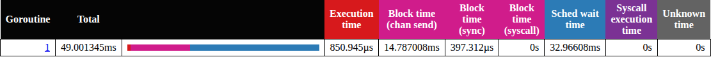
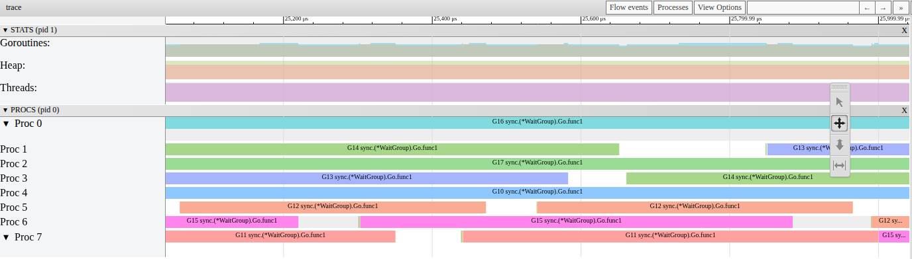

# P1-12. Паузу перед кражей runnext делает сам вор, и на WSL она около 60 мкс

**Сказано (50:26–50:56):** «А main находится за ним в runnext. И получается, что main может забрать только другой P, который освободится: произойдет work stealing. Но runnext крадут в последнюю очередь, и после небольшой паузы, примерно в 3 микросекунды, которая есть у sysmon.»

**Как правильно:** механизм верный, но паузу usleep(3) делает P, который крадет runnext, а
не sysmon; на этой машине (WSL) она ~60 мкс. main ждет ~0.1 мс за раз: его обычно крадут
раньше, чем воркер доделает задачу. Всего 33 мс.

На практике я верно описал механизм. main просыпается в runnext того P, где работает воркер.
Забрать его оттуда может только другой P, кражей. runnext крадут в последнюю очередь, и перед
этим в коде есть пауза 3 мкс. Неверно две вещи. Паузу делает не sysmon, а сам P, который
крадет. И длится она не 3 мкс: на этой машине около 60.

## Что видно в трейсе

Давайте начнем с main. Откройте живой трейс шага 4, Goroutine analysis, main.main:



Мы видим, что main работал всего 0.85 мс. А готов к работе, но без P, он был 32.97 мс. Это
колонка Sched wait. За шаг main просыпается 281 раз, и обычно ждет P около 0.1 мс (медиана
0.114 мс). Куда уходит это время?

Возьмем одну миллисекунду из середины шага, от 25 до 26 мс. Каждая строка это P.


Что мы видим? Рамка значит: main готов и стоит в runnext этого P. Штриховка отмечает вора: P,
который потом заберет main, уже свободен, а main уже ждет. Стрелка показывает кражу. Сам main
работает так коротко, что на картинке его не видно.

Есть и серые промежутки без штриховки. Это свободный P, который main не забрал. Например, P1
свободен с 25.62 мс, а main готов только с 25.69 мс. Или P5 на 25.92–25.95 мс: main в это время
ждет на P0, но его забирает P6.

Давайте разберем один случай, на P4 и P6. На 25.126 мс воркер G10 на P4 берет задачу у main и будит
его. Дальше G10 выполняет задачу, и P4 занят. На 25.178 мс воркер G15 на P6 доделал свою
задачу. Новой в канале нет, и G15 засыпает. P6 свободен. Но main он запускает только на
25.259 мс, через 81 мкс. main отдает задачу G15 и снова засыпает на отправке.

Что мы увидим в `go tool trace`? Ту же миллисекунду в View trace by proc:



Промежутки в строках Proc это P без горутины. Те из них, что кончаются запуском main, это воры.
Почему P6 ждал 81 мкс, если main уже был готов? Давайте посмотрим в код.

## Как main попадает в runnext

Начнем с нашего кода
([run.go#L16-L25](../step4-workerpool/run.go#L16-L25)):

```go
for range max(n, 1) {
	wg.Go(func() {
		for t := range queue {
			t()
		}
	})
}
for _, t := range tasks {
	queue <- t
}
```

У нас канал небуферизированный: `queue := make(chan func())`
([run.go#L14](../step4-workerpool/run.go#L14)). main отдает задачи по одной. Если свободного воркера нет, main
засыпает на `queue <- t`. Воркер, который пришел за задачей, забирает ее у main и будит его
([chan.go#L745](https://github.com/golang/go/blob/go1.27.1/src/runtime/chan.go#L745),
[proc.go#L493-L496](https://github.com/golang/go/blob/go1.27.1/src/runtime/proc.go#L493-L496)):

```go
func goready(gp *g, traceskip int) {
	systemstack(func() {
		ready(gp, traceskip, true)
	})
```

Куда попадет main? Третий аргумент `true` значит: в runnext. Дальше `ready` кладет main в runnext и вызывает
`wakep`. Тот будит еще один P, только если сейчас никто не ищет работу
([P1-01](P1-01.md#почему-p-включаются-по-одному))
([proc.go#L1150-L1151](https://github.com/golang/go/blob/go1.27.1/src/runtime/proc.go#L1150-L1151)):

```go
runqput(mp.p.ptr(), gp, next)
wakep()
```

`mp.p` это P воркера, который разбудил main. То есть у нас main стоит в runnext у P4. А воркер G10
никуда не уходит: он только что получил задачу и выполняет ее. После того как разбудил main,
воркер работает еще 0.42 мс (медиана). Получается, на своем P main запустится не раньше, чем
воркер доделает задачу.

## Кто забирает main

Но на картинке мы видели другой путь, кражу. Ее делает P, у которого кончилась работа. У нас это P6: его воркер
доделал задачу и заснул на пустом канале. Свободный P ищет работу по порядку: своя очередь,
глобальная очередь, сеть. Только потом он идет красть у других P, если ищущих работу потоков не слишком много
([proc.go#L3532-L3537](https://github.com/golang/go/blob/go1.27.1/src/runtime/proc.go#L3532-L3537)).
Крадет он за 4 прохода по всем P, и runnext трогает только на последнем
([proc.go#L3848-L3850](https://github.com/golang/go/blob/go1.27.1/src/runtime/proc.go#L3848-L3850)):

```go
const stealTries = 4
for i := 0; i < stealTries; i++ {
	stealTimersOrRunNextG := i == stealTries-1
```

То есть runnext действительно крадут в последнюю очередь. Кто был вором в нашем трейсе? Мы видим, что из 245
случаев, когда main забрал другой P, в 235 это P, чей воркер только что заснул на канале.
Остальные 10 это P, которые до этого простаивали.

## Пауза: usleep(3) в runqgrab

Что делает вор, когда добрался до чужого runnext? Спит он не всегда. Своя очередь у жертвы должна
быть пуста, а сама жертва должна работать и не стоять в системном вызове
([proc.go#L7719-L7725](https://github.com/golang/go/blob/go1.27.1/src/runtime/proc.go#L7719-L7725)).
У нас так и есть: воркер на P4 считает задачу. Давайте посмотрим на начало комментария в
`runqgrab`, он продолжается до строки 7744
([proc.go#L7726-L7735](https://github.com/golang/go/blob/go1.27.1/src/runtime/proc.go#L7726-L7735)):

```go
// Sleep to ensure that pp isn't about to run the g
// we are about to steal.
// The important use case here is when the g running
// on pp ready()s another g and then almost
// immediately blocks. Instead of stealing runnext
// in this window, back off to give pp a chance to
// schedule runnext. This will avoid thrashing gs
// between different Ps.
// A sync chan send/recv takes ~50ns as of time of
// writing, so 3us gives ~50x overshoot.
```

Смысл такой. Горутина часто будит другую и тут же сама засыпает. Тогда ее P сейчас сам возьмет
runnext. Если украсть его в этот момент, горутины будут скакать между P. Поэтому вор сначала
ждет
([proc.go#L7745-L7752](https://github.com/golang/go/blob/go1.27.1/src/runtime/proc.go#L7745-L7752)):

```go
if !osHasLowResTimer {
	usleep(3)
} else {
	// On some platforms system timer granularity is
	// 1-15ms, which is way too much for this
	// optimization. So just yield.
	osyield()
}
```

Получается, в нашем случае спит вор, P6, перед тем как забрать main. У sysmon своя пауза, от 20 мкс до
10 мс
([proc.go#L6549-L6557](https://github.com/golang/go/blob/go1.27.1/src/runtime/proc.go#L6549-L6557)),
и main она не задерживает.

Как нам убедиться, что спит именно вор? strace показывает каждый вызов `nanosleep` вместе со
стеком. В трех запусках шага 4 все паузы по 3 мкс шли из `runqgrab` через `stealWork`. Паузы
sysmon начинаются с 20 мкс. А если собрать runtime без этой строки? Тогда вор запускает main через
0.001 мс (медиана). И шаг 4 идет 39.5 мс вместо 47.6 мс (медианы 20 запусков).

Почему именно 3 мкс? В 2015 году здесь было `usleep(100)`
([CL 9872](https://go-review.googlesource.com/9872)). В 2016 паузу сократили до 3 мкс
([CL 20835](https://go-review.googlesource.com/20835)). Обоснование в том же комментарии:
передача по каналу занимает около 50 нс, и 3 мкс дают запас в «~50x». На Windows, OpenBSD и
NetBSD вор не спит, а уступает процессор (`osyield`). Таймер там грубый, от 1 мс
([proc.go#L1119-L1121](https://github.com/golang/go/blob/go1.27.1/src/runtime/proc.go#L1119-L1121)).

## Почему не 3 мкс, а 60

`usleep` на Linux это системный вызов `nanosleep`
([sys_linux_amd64.s#L130-L134](https://github.com/golang/go/blob/go1.27.1/src/runtime/sys_linux_amd64.s#L130-L134)):

```asm
// nanosleep(&ts, 0)
MOVQ	SP, DI
MOVL	$0, SI
MOVL	$SYS_nanosleep, AX
SYSCALL
```

А `nanosleep` в Linux подчиняется timer slack. Ядру разрешено разбудить поток позже, на величину
slack, чтобы объединить пробуждения. По умолчанию slack 50 мкс, и Go его не меняет. То есть
runtime просит 3 мкс, а ядро вправе разбудить поток на 50 мкс позже. Замер дает около 60 мкс.

Может, это Go? Нет. `nanosleep` на 3 мкс в программе на Go длится 61.2–68.4 мкс (медиана). Та же
пауза в программе на C длится 60.5–63.4 мкс. При timer slack 1 нс обе около 10 мкс.

И это не только у нас. В 2017 году в Go записали: «The usleep(3) has been observed
delaying execution of woken G's by ~60us»
([CL 78538](https://go-review.googlesource.com/78538)). Эту паузу обсуждают и сейчас, уже после
go1.27.1. В [issue #81657](https://github.com/golang/go/issues/81657) пишут: на linux/amd64
`usleep(3)` обычно длится 50–60 мкс.

## Откуда ~0.1 мс и почему крадут раньше

Давайте сложим. Мы видим два этапа ожидания. Сначала main ждет, пока какой-нибудь воркер
доделает задачу и освободит P. В живом трейсе это 0.030 мс (медиана). Потом этот P проходит
кражу и спит. Это 0.080 мс. Все ожидание 0.114 мс (медиана). Это медианы по разным наборам:
этапы считаются для 245 краж, а все ожидание по всем 281 пробуждениям, поэтому они не
складываются точно.

А воркер, который разбудил main, работает еще 0.42 мс. Какой P освободится раньше? Для main подходит любой из семи
других, а не только этот. Поэтому main обычно крадут: в 243 случаях из 281 другой P забрал main, пока разбудивший
воркер еще работал. 36 раз main дождался своего P. Из них 35 в первые 5 мс
шага, когда P еще включаются по одному ([P1-06](P1-06.md)). После 5 мс украдены 223 из 224.

Всего за шаг main у нас прождал 32.97 мс. Это и есть наши 33 мс. Шаг 5 убирает это ожидание: задачи
кладутся в канал заранее, и main в цикле не нужен.

## Замер

i5-13600KF, WSL2, 20 логических CPU, go1.27.1. Живой трейс записан 9 октября 2026, остальное
10 октября 2026. Шаг 4, `-cpu=8`, бинарь из `practice`.

| Что | Значение |
|---|---|
| живой трейс: main | работал 0.851 мс, ждал P 32.966 мс, проснулся 281 раз |
| живой трейс: ожидание main за раз | медиана 0.114 мс, 90% до 0.178 мс, максимум 0.253 мс |
| живой трейс: кто запустил main | другой P 245 раз (вор после своего воркера 235, простаивавший P 10), свой P 36 |
| живой трейс: украден, пока разбудивший воркер работал | 243 из 281; после 5 мс 223 из 224 |
| живой трейс: воркер работает после того, как разбудил main | медиана 0.422 мс, 90% до 1.060 мс |
| живой трейс: ожидание main по этапам | пока освободится P: медиана 0.030 мс; от этого до запуска main: медиана 0.080 мс, 10–90% 0.065–0.111 мс |
| 120 новых трейсов | пробуждений 254–331, ожидание за раз (медиана) 0.094–0.145 мс, всего 30.25–39.80 мс |
| `nanosleep` 3 мкс, slack 50 мкс | Go 61.2–68.4 мкс, C 60.5–63.4 мкс (медиана) |
| `nanosleep` 3 мкс, slack 1 нс | Go 10.2–11.2 мкс, C 10.3–10.7 мкс (медиана) |
| strace, 3 запуска | паузы по 3 мкс: 115, 102, 121, все из `runqgrab` |
| runtime без `usleep(3)`, 20 запусков | шаг 4 39.5 мс против 47.6 мс (медианы) |

## Не проверено

- Вор ждет 0.080 мс, а пауза в отдельной программе длится 61.2–68.4 мкс. Откуда еще примерно
  12–19 мкс, не установлено. При slack 1 нс разницы почти нет.
- На Linux без виртуализации, на macOS и на Windows не проверялось. На Windows вор вместо паузы
  вызывает `osyield`.

## Проверить самому

Сначала соберите бинарь: `sh run.sh` из `week-01-scheduler/practice` (он кладет его в `bin/`).
Потом откройте живой трейс, оттуда же:

```sh
go tool trace -http=127.0.0.1:6060 corrections/assets/p1-12-live-step4.out
```

Goroutine analysis, `main.main`: Sched wait около 33 мс. Потом View trace by proc, 25–26 мс от
начала шага (в трейсе 25.042–26.042 мс). Промежутки в строках Proc это P без горутины; те, что кончаются
запуском main, это воры.

А теперь паузы вора в своем запуске (только Linux). strace печатает каждый `nanosleep`. Строки с
`tv_nsec=3000` это `usleep(3)`:

```sh
strace -f -e trace=nanosleep bin/practice -step=4 -cpu=8 -reps=1 2>&1 | grep -c 'tv_nsec=3000}'
```

strace замедляет программу, поэтому смотрите только на счет, не на время.
