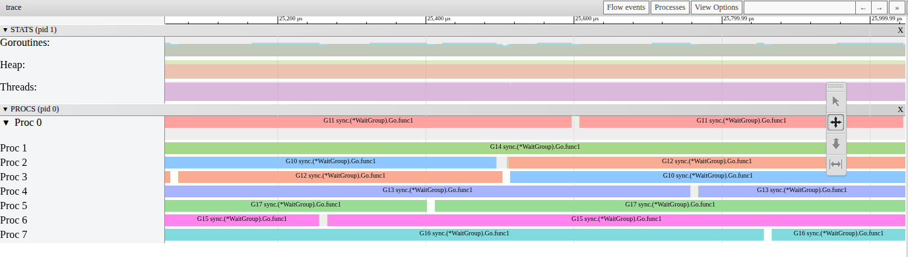
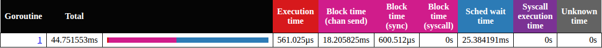

# P1-15. Шаг 4 теряет не на переключениях, а на ожидании

**Сказано (1:00:52–1:01:00):** «У нас все это на контекст свитчинг между main тратится. Почему бы нам просто взять и не убрать тогда этот контекст свитчинг?»

**Как правильно:** теряем не на самих переключениях, а на ожидании: main готов, но ждет P.
Проверка (WSL): при timer slack 1 нс переключений на main стало больше (410 против 283), а
шаг 4 ускорился примерно на 6 мс.

На практике я верно увидел, что потери шага 4 связаны с main. Но время уходит не на сами
переключения на main, а на то, что main ждет свободный P.

## Сколько стоят переключения

Давайте посмотрим на main в живом трейсе шага 4. Как его открыть, показано в [P1-12](P1-12.md). За весь
шаг main выполнялся 0.85 мс. А ждал P 32.97 мс. Переключений на main было 281.

Можно ли по этим 0.85 мс оценить цену переключений? Не совсем. Execution time считает только
время, когда main выполнялся сам. Работа планировщика между засыпанием main и его запуском сюда
не входит. Поэтому проверим иначе.

Что переключения в Go недорогие, мы уже видели в шаге 1. Там 1000 горутин на одном P работают
как обычный цикл ([P1-01](P1-01.md)). Тогда куда уходит время? И как проверить, что дело не в
переключениях?

## Проверка: переключений больше, а шаг быстрее

Давайте прикинем. Если бы время уходило на переключения, то при большем их числе шаг стал бы
медленнее. А если время уходит на ожидание, то при более коротком ожидании шаг станет быстрее,
даже если переключений больше.

Ожидание можно укоротить. Перед кражей main вор спит `usleep(3)`. Из-за timer slack 50 мкс эта
пауза длится около 60 мкс, мы видели это в [P1-12](P1-12.md#почему-не-3-мкс-а-60). При timer
slack 1 нс она около 10 мкс.

Что мы получаем? Замер 9 октября, та же машина:

| | timer slack 50 мкс | timer slack 1 нс |
|---|---|---|
| шаг 4, 6 пар запусков вперемешку | 46.3–47.0 мс, медиана 46.45 | 40.0–41.0 мс, медиана 40.9 |
| переключений на main за шаг | 283 | 410, 410, 420 |
| main ждал P за шаг | 31.63 мс | 22.74–23.96 мс |

Получается, переключений на main стало больше, почти в полтора раза. А шаг 4 стал быстрее
примерно на 6 мс. Это медиана разниц по парам: 5.75 мс 9 октября и 6.4 мс 10 октября. То есть
теряем не на переключениях.

Откуда эти числа? 283 и 410 взяты из трейсов, записанных вечером после практики. 283 это самый быстрый
из пяти пробных запусков при обычном slack. При 1 нс три одиночные записи: в двух 410, в третьей 420. В живом трейсе из видео переключений 281 ([P1-12](P1-12.md)).
10 октября то же сравнение повторено на 120 парах трейсов: медиана 289 против 392.

## Что меняет timer slack

Ожидание main состоит из двух этапов ([P1-12](P1-12.md#откуда-01-мс-и-почему-крадут-раньше)).
Сначала main ждет, пока какой-нибудь воркер освободит P. Потом этот P крадет main, и перед кражей
спит. Какой этап укорачивает slack? Давайте сравним (медианы):

| | пока освободится P | от этого до запуска main |
|---|---|---|
| slack 50 мкс, 120 трейсов | 0.032 мс | 0.080 мс |
| slack 1 нс, 120 трейсов | 0.038 мс | 0.011 мс |
| runtime без `usleep(3)`, 60 трейсов | 0.032 мс | 0.001 мс |

Мы видим, что первый этап почти не меняется. Меняется второй, и он идет за паузой вора.
Получается, slack действует на шаг 4 только через эту паузу.

На картинке это видно сразу. Возьмем ту же миллисекунду шага 4, от 25 до 26 мс. Сначала при
обычном slack, как в [P1-12](P1-12.md). Потом при 1 нс:


Второй трейс это `p1-15-slack1.out`: запуск 10 октября при slack 1 нс, 395 переключений на main.
Из 120 трейсов он ближе всего к медианам набора.

Штриховка, то есть вор без горутины перед кражей, стала тонкой полоской. Рамки, где main ждет,
стали короче, но не исчезли: это первый этап.

В `go tool trace` (View trace by proc) та же миллисекунда этого трейса выглядит так. Сравните с
картинкой в [P1-12](P1-12.md): промежутки между задачами стали едва заметны.



## Почему переключений стало больше

Почему main при коротком ожидании переключается чаще? Давайте посмотрим, когда main вообще
засыпает. Отправка в канал сначала ищет воркера, который уже ждет задачу
([chan.go#L229-L234](https://github.com/golang/go/blob/go1.27.1/src/runtime/chan.go#L229-L234)):

```go
if sg := c.recvq.dequeue(); sg != nil {
	// Found a waiting receiver. We pass the value we want to send
	// directly to the receiver, bypassing the channel buffer (if any).
	send(c, sg, ep, func() { unlock(&c.lock) }, 3)
	return true
}
```

Если такой воркер есть, main отдает задачу ему и не засыпает. Засыпает main, только когда
ждущих воркеров нет. Каждое такое засыпание это потом одно пробуждение, то есть одно
переключение.

Теперь сложим. Пока main ждет около 60 мкс паузы вора, другие воркеры доделывают задачи и встают в
очередь за новыми. Когда main наконец работает, он раздает задачи сразу нескольким ждущим и засыпает
реже. При slack 1 нс main возвращается быстрее, ждущих воркеров меньше, и засыпает он чаще.

В трейсах так и есть. В первой колонке только задачи, которые main отдал уже ждущим воркерам за
один запуск. Еще одну задачу он отдает той отправкой, на которой засыпает:

| | отдал ждущим воркерам за один запуск main | отдал ждущему / заснул, за шаг |
|---|---|---|
| живой трейс, slack 50 мкс | 2.56 | 722 / 280 |
| 9 октября, slack 1 нс | 1.38–1.44 | 592 / 409 (один трейс) |
| 120 трейсов, slack 50 мкс | 2.48 (медиана) | |
| 120 трейсов, slack 1 нс | 1.55 (медиана) | |

В 722 входят и около 2 пробуждений воркеров от `close`. Поэтому 722 + 280 чуть больше 1000 задач.

Получается, больше переключений значит меньше ожидания. А ждали у нас не только main, но и
воркеры. При обычном slack воркеры в сумме простояли без задачи 38.59 мс. При
slack 1 нс 10.14 мс. Это медианы по 120 трейсам.

## Что исправляет шаг 5

Почему тогда шаг 5 быстрее? Он убирает main из цикла совсем
([run.go#L14-L18](../step5-prefilled/run.go#L14-L18)):

```go
queue := make(chan func(), len(tasks))
for _, t := range tasks {
	queue <- t
}
close(queue)
```

У нас все задачи лежат в канале до старта воркеров. Воркеру не нужно ждать, пока main проснется, и
никто не ждет в runnext. То есть шаг 5 убирает само ожидание, а не переключения.

## Замер

i5-13600KF, WSL2, 20 логических CPU, go1.27.1. Шаг 4, `-cpu=8`. Числа из плашки получены
9 октября 2026. Трейсы 9 октября (283, 410, 420) записаны бинарем из приватной копии кода курса,
поэтому не опубликованы. Остальное получено 10 октября 2026 бинарем из `practice`.

| Что | timer slack 50 мкс | timer slack 1 нс |
|---|---|---|
| 9 октября: шаг 4, 6 пар вперемешку, медиана 5 запусков в каждом | 46.3–47.0 мс, медиана 46.45 | 40.0–41.0 мс, медиана 40.9 |
| 10 октября: шаг 4, 100 пар вперемешку | 46.8–50.4 мс, медиана 47.7 | 39.8–44.9 мс, медиана 41.4 |
| 9 октября: переключений на main за шаг | 283 (один трейс) | 410, 410, 420 (три трейса) |
| 10 октября, 120 пар трейсов: переключений на main | 254–331, медиана 289 | 346–430, медиана 392 |
| 120 пар: main ждал P за шаг | 30.25–39.80 мс, медиана 34.62 | 22.48–32.99 мс, медиана 25.38 |
| 120 пар: main работал за шаг | 0.53–0.99 мс | 0.40–1.03 мс |
| 120 пар: ожидание main за раз (медиана трейса) | 0.094–0.145 мс | 0.040–0.078 мс |
| 120 пар: воркеры без задачи, сумма | 32.86–47.98 мс, медиана 38.59 | 6.31–20.40 мс, медиана 10.14 |
| пауза `usleep(3)`, медиана | 61.2–68.4 мкс | 10.2–11.2 мкс |

В 100 парах из 100 шаг 4 при slack 1 нс быстрее. Разница от 2.1 до 9.5 мс, медиана 6.4 мс
(9 октября 5.75 мс).

## Не проверено

- 10 октября шаг 4 медленнее, чем 9 октября. При slack 50 мкс на 1.25 мс (медиана 47.7 против
  46.45). При 1 нс на 0.5 мс (41.4 против 40.9). Выигрыш от slack 1 нс вырос с 5.75 до 6.4 мс
  (медиана разниц по парам). Тот же бинарь, без сборок мусора, после паузы 2 с результат тот же.
  Почему, не установлено.
- На Linux без виртуализации, на macOS и на Windows не проверялось (про Windows в
  [P1-12](P1-12.md#не-проверено)).

## Проверить самому

Сначала соберите бинарь: `sh run.sh` из `week-01-scheduler/practice`. Потом откройте два трейса
оттуда же. Сравните в Goroutine analysis строку
`main.main`, колонку Sched wait:

```sh
go tool trace -http=127.0.0.1:6060 corrections/assets/p1-12-live-step4.out
go tool trace -http=127.0.0.1:6061 corrections/assets/p1-15-slack1.out
```

В первом около 33 мс. Во втором, `p1-15-slack1.out`, у нас около 25 мс:



А теперь свой запуск. Только Linux. Timer slack задается до запуска программы. Каждый новый поток
получает slack от потока, который его создал. Поэтому все потоки Go получат значение,
с которым программа стартовала:

```sh
bin/practice -step=4 -cpu=8
sh -c 'echo 1 > /proc/self/timerslack_ns && exec bin/practice -step=4 -cpu=8'
```

Здесь `sh` ставит slack себе и заменяет себя программой, поэтому привилегии не нужны. Изменить
slack уже работающей программы так не получится. Чтобы проверить значение, читайте
`/proc/self/timerslack_ns` изнутри процесса: чужой файл `cat` прочитать не даст.
