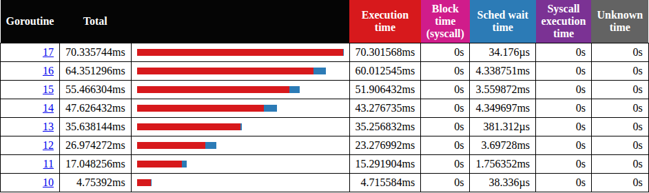
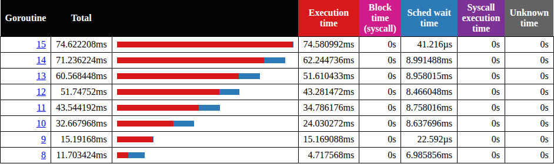
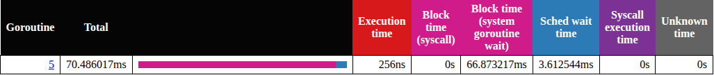
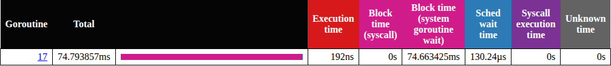

# P1-16. Номера горутин 8 и 10: от шага это не зависит

**Спросили (1:07:04–1:07:22):** «Тут, видимо, системных горутин меньше, потому что мы начинаем с восьмой, а не с десятой. Почему? В других случаях горутины у нас были 10, 11, 12 и так далее, а тут с восьмой.»

**Сказано (1:07:28–1:07:41):** «Хороший вопрос. Я его запомню, чтобы ответить в начале следующей лекции. Честно скажу, пока не могу на него ответить.»

**Как правильно:** от шага это не зависит: и 8, и 10 бывают в каждом шаге. Id выдаются
каждому P пачками по 16.

На практике заметили верно. В трейсе шага 5 воркеры начинались с G8, а в других трейсах с
G10. Я тогда не смог ответить. Ответ ниже. Догадка про служебные горутины была близко: разница
именно в них. Только их не меньше. Их столько же, восемь. Но пять из них получают другие
номера: две горутины runtime и три горутины трейса. А шаг здесь ни при чем.

## Что мы видим

Возьмем два запуска одного и того же шага 3. Первый это живой трейс из
[P1-06](P1-06.md). Второй записан заново из того же кода. Откроем в `go tool trace` Goroutine
analysis, группу `sync.(*WaitGroup).Go.func1`. Это наши 8 воркеров.

Живой трейс, воркеры G10–G17:



Новый трейс, воркеры G8–G15:



Мы видим: шаг один и тот же, а номера разные. Почему тогда на практике это было похоже на разницу между
шагами? Трейсы шагов 3 и 4 записаны на практике, в 20:06 и в 20:26. Оба
начинались с G10. А шаг 5 был открыт запасным трейсом. Его тоже записали во время практики,
в 20:22, и в нем воркеры начинались с G8. То есть так совпало.
Какой номер получит первый воркер, решается заново в каждом запуске.

## Откуда берется номер

Может, номер это просто порядковый номер горутины в программе? Не совсем. Общий счетчик
есть, но горутина берет номер не прямо из него. Каждый P забирает из счетчика пачку номеров
([proc.go#L764-L768](https://github.com/golang/go/blob/go1.27.1/src/runtime/proc.go#L764-L768)):

```go
const (
	// Number of goroutine ids to grab from sched.goidgen to local per-P cache at once.
	// 16 seems to provide enough amortization, but other than that it's mostly arbitrary number.
	_GoidCacheBatch = 16
)
```

Давайте посмотрим, где эта пачка расходуется. Это `newproc1`, создание новой горутины
([proc.go#L5429-L5439](https://github.com/golang/go/blob/go1.27.1/src/runtime/proc.go#L5429-L5439)):

```go
	if pp.goidcache == pp.goidcacheend {
		// Sched.goidgen is the last allocated id,
		// this batch must be [sched.goidgen+1, sched.goidgen+GoidCacheBatch].
		// At startup sched.goidgen=0, so main goroutine receives goid=1.
		pp.goidcache = sched.goidgen.Add(_GoidCacheBatch)
		pp.goidcache -= _GoidCacheBatch - 1
		pp.goidcacheend = pp.goidcache + _GoidCacheBatch
	}
	newg.goid = pp.goidcache
	casgstatus(newg, _Gdead, status)
	pp.goidcache++
```

`pp` здесь это P, на котором работает тот, кто вызвал `go`. Если у этого P номера кончились,
он забирает следующие 16 из общего счетчика `sched.goidgen`. Дальше раздает их по одному.
Получается, первый P получает номера 1–16, следующий P 17–32, потом 33–48. То есть номер
горутины зависит от того, на каком P ее создали.

## Кто занимает номера до воркеров

До наших воркеров создаются еще восемь горутин: пять создает runtime, а три горутины
трейса запускает наш `trace.Start`. Их видно в том же Goroutine analysis,
по имени стартовой функции. Во всех 520 новых трейсах с `-cpu=8` номера были такие:

| id | стартовая функция |
|---|---|
| 1 | `main.main` |
| 2 | `runtime.forcegchelper` |
| 3 | `runtime.bgsweep` |
| 4 | `runtime.bgscavenge` |
| 5 или 17 | `runtime.updateMaxProcsGoroutine` |
| 6 или 18 | `runtime.runFinalizers` |
| следующие три | горутины трейса: `runtime.traceStartReadCPU.func1`, `runtime.(*traceAdvancerState).start.func1`, `runtime/trace.(*traceMultiplexer).startLocked.func1` |
| дальше | воркеры, `sync.(*WaitGroup).Go.func1` |

Чем тогда отличаются наши два трейса? Набор горутин у нас одинаковый, весь вопрос в двух
строках: 5 и 6 или 17 и 18. Мы видим, что в живом трейсе `updateMaxProcsGoroutine` получила
номер 5:



А в новом мы видим 17:



Давайте разложим оба случая по пачкам:


В первом случае все служебные горутины получили номера из пачки P0, 2–9 (1 это main), и воркеры
начинаются с 10. Номера P0 кончаются на 16, поэтому восьмой воркер берет 17 уже из второй
пачки P0. Во втором случае 17 и 18 взяты из пачки другого P. У P0 номера 5–16 остаются
свободными. Их и получают горутины трейса (5–7) и воркеры (8–15).

## Почему main оказывается на другом P

Обе горутины, 5 и 6, создает main еще до нашего кода. Значит, вопрос такой: на каком P main
был в этот момент? Давайте посмотрим, что runtime делает при старте
([mgc.go#L211-L219](https://github.com/golang/go/blob/go1.27.1/src/runtime/mgc.go#L211-L219)):

```go
func gcenable() {
	// Kick off sweeping and scavenging.
	c := make(chan int, 2)
	go bgsweep(c)
	go bgscavenge(c)
	<-c
	<-c
	memstats.enablegc = true // now that runtime is initialized, GC is okay
}
```

main создает `bgsweep` (обычно 3) и `bgscavenge` (обычно 4) и ждет от них сигнала в канале. Пока runtime
инициализируется, main привязан к своему потоку
([proc.go#L189](https://github.com/golang/go/blob/go1.27.1/src/runtime/proc.go#L189)). Поэтому,
когда main ждет, его поток отпускает P0, и P0 может достаться другому потоку.

Дальше `bgsweep` и `bgscavenge` работают на каких-то P и отправляют в канал. Канал
буферизованный, на два значения. Поэтому не каждая отправка будит main: если значение уже
лежит в канале, main забирает его и не засыпает. Но если main ждал, отправка его будит. Куда
он попадает? В очередь P того, кто отправил
([proc.go#L1150](https://github.com/golang/go/blob/go1.27.1/src/runtime/proc.go#L1150)):

```go
	runqput(mp.p.ptr(), gp, next)
```

Этот P берет main из очереди и видит, что main привязан к своему потоку. Тогда P передает
себя этому потоку
([proc.go#L4238-L4243](https://github.com/golang/go/blob/go1.27.1/src/runtime/proc.go#L4238-L4243)):

```go
	if gp.lockedm != 0 {
		// Hands off own p to the locked m,
		// then blocks waiting for a new p.
		startlockedm(gp)
		goto top
	}
```

Получается, как правило, main продолжает работу на P отправителя. Это может быть P0, а может быть другой P.
По умолчанию при старте P столько, сколько CPU доступно процессу, у нас 20. Дальше main
создает `updateMaxProcsGoroutine` и `runFinalizers`. На P0 они получают 5 и 6. На другом P,
например P18 или P19, номеров еще нет. Этот P берет пачку 17–32, и они получают 17 и 18.

Как часто main оказывается на другом P? Отдельная упрощенная пробная программа делает до
`trace.Start` похожие шаги. Она печатает P, на котором main, при инициализации пакета main,
то есть уже после создания этих двух горутин. В 100 запусках это был P0 20 раз, P18 39 раз и
P19 41 раз.

Как тогда main возвращается на P0 до воркеров? Это делает наш же код
([main.go#L77-L80](../cmd/practice/main.go#L77-L80)):

```go
		p := cpus[0]
		runtime.GOMAXPROCS(p)
		n := bound(*nFlag, p)
		d, l := traced(*traceFlag, steps[0], n, *tasksFlag, *shapeFlag)
```

`runtime.GOMAXPROCS(8)` оставляет P0–P7, а P18 и P19 больше нет. Тогда runtime переводит main
на P0
([proc.go#L6156-L6160](https://github.com/golang/go/blob/go1.27.1/src/runtime/proc.go#L6156-L6160)):

```go
		gp.m.p = 0
		pp := allp[0]
		pp.m = 0
		pp.status = _Pidle
		acquirep(pp)
```

А на P0 номера 5–16 еще не тронуты. Получается, воркеры начинаются с 8.

## Почему это не шаг

Какой номер получит первый воркер, решается до того, как шаг начался. Давайте посмотрим,
где шаг запускается
([main.go#L144-L148](../cmd/practice/main.go#L144-L148)):

```go
	if err := trace.Start(f); err != nil {
		fail(err)
	}
	start := time.Now()
	trace.WithRegion(ctx, s.Name, func() { s.Run(n, wrapped) })
```

`s.Run` вызывается только после `trace.Start`. А все, что решает номер, случилось раньше: при
старте runtime и в начале нашего `main`, в `runtime.GOMAXPROCS(8)` и в создании файла трейса.
Этот код один и тот же для всех шагов. То есть 8 или 10 решает гонка потоков при старте:
на каком P main окажется, когда его разбудят в `gcenable` в последний раз. Вариант 36 решается
позже, уже в нашем `main`, обычно при создании файла трейса. Сам порядок потоков напрямую не
наблюдался, об этом ниже, в «Не проверено».

Можно ли это проверить? Да. Если оставить программе один CPU (`taskset -c 0`), то при старте
будет только P0. Тогда main некуда уйти, и мы ожидаем, что воркеры всегда начинаются с 10. Так и есть:
100 из 100. Вторая проверка: убрать `updateMaxProcsGoroutine` (`GODEBUG=updatemaxprocs=0`).
Тогда в первом случае служебных горутин на одну меньше, то есть 10 должно стать 9. И мы получаем 9
в 40 запусках из 100, а 10 ни разу.

Бывает и третий вариант. В 25 запусках из 500 воркеры начинались с 36. В них main к старту
трейса оказывался на P5–P7. Этот P брал третью пачку, 33–48, и горутины трейса получали
33–35. Получается, правило то же: номер дает P, на котором создали горутину.

## Замер

i5-13600KF, WSL2, 20 логических CPU, go1.27.1. Живой и запасные трейсы записаны на практике
9 октября 2026. Остальное 10 октября: бинарь из `practice`, собранный с `-trimpath`, `-cpu=8`, если
не сказано иначе, пауза 0.3 с перед каждым запуском. Меньше CPU получено через `taskset`.

| Что | Первый воркер |
|---|---|
| живой трейс шага 3 и шага 4 | 10 (`updateMaxProcsGoroutine` 5) |
| запасные трейсы шагов 3, 4, 5, 20:22 | 8 (`updateMaxProcsGoroutine` 17) |
| шаг 1, 100 трейсов | 8 в 65, 10 в 30, 36 в 5 |
| шаг 2, 100 трейсов | 8 в 64, 10 в 31, 36 в 5 |
| шаг 3, 100 трейсов | 8 в 68, 10 в 27, 36 в 5 |
| шаг 4, 100 трейсов | 8 в 75, 10 в 20, 36 в 5 |
| шаг 5, 100 трейсов | 8 в 63, 10 в 32, 36 в 5 |
| правило, 500 трейсов | 5 и 6: всегда 10 (140); 17 и 18: 8 (335) или 36 (25) |
| пробная программа: P main при инициализации пакета main, 100 запусков | P0 20, P18 39, P19 41; P0 всегда дает 10 |
| `taskset -c 0`, шаги 1–5 по 20 | 10 во всех 100 |
| `GODEBUG=updatemaxprocs=0`, шаг 3, 100 | 9 в 40, 8 в 51, 36 в 9 |
| 8 CPU (`taskset -c 0-7`), шаг 3, 100 | 22 в 64, 10 в 29, 20 в 4, 36 в 2, 8 в 1 |
| 4 CPU (`taskset -c 0-3`), шаг 3, 100 | 10 в 53, 22 в 42, 20 в 3, 36 в 1, 8 в 1 |
| 12 CPU (`taskset -c 0-11`), шаг 3, 100 | 10 в 48, 8 в 46, 36 в 5, 7 в 1 |
| `-cpu=1`, шаг 3, по 100 на 4, 8 и 20 CPU, рядом шла другая работа | 8 в 54, 61, 77; 10 в 46, 39, 22; 6 в 1 (на 20 CPU) |
| `GOMAXPROCS=8` в окружении, шаг 3, 100 | 22 в 47, 10 в 46, 8 в 5, 20 в 2 |

Последняя строка показывает, почему важен возврат на P0. С `GOMAXPROCS=8` в окружении P
с 8 по 19 нет с самого старта. `runtime.GOMAXPROCS(8)` ничего не меняет, и main обычно остается
на том P, где был. Если это не P0, этот P берет пачку 17–32, и воркеры начинаются с 22. Так
было в 47 запусках из 100, а в 46 воркеры начинались с 10.

## Не проверено

Какой поток будит main в `gcenable` в последний раз, напрямую не наблюдалось. Видно только
результат: на каком P оказался main (100 запусков пробной программы). Путь через `runqput`
наблюдался под отладчиком Delve в 6 запусках. Саму передачу P потоку main отладчик не поймал.
И отладчик сам меняет порядок потоков.

Почему в 25 запусках из 500 main к старту трейса оказывается на P5–P7, не установлено.

Доли 8 и 10 зависят от числа CPU. И, похоже, зависят от фоновой нагрузки. Пробная программа видела
main на P0 в 20 запусках из 100, когда рядом не было других задач. А когда рядом шла другая
работа, в 34 и 37. На Linux без
виртуализации и на macOS не проверялось.

Редкие номера 6, 7 и 20 бывают от одного до четырех раз на сотню. Их объясняет то же правило
пачек. А почему main в этих запусках меняет P в другой момент, не установлено.

## Проверить самому

Откройте оба трейса из этого разбора. Из `week-01-scheduler/practice`:

```sh
go tool trace -http=127.0.0.1:6060 corrections/assets/p1-06-live-step3.out
go tool trace -http=127.0.0.1:6061 corrections/assets/p1-16-step3-first8.out
```

Дальше Goroutine analysis. Сравните номера в группах `sync.(*WaitGroup).Go.func1` и
`runtime.updateMaxProcsGoroutine`.

А теперь свои запуски. Сначала соберите бинарь. Его собирает `sh run.sh`, запущенный из
`week-01-scheduler/practice` (см. [README практики](../README.md)). Номер первого воркера печатает такой цикл:

```sh
for i in 1 2 3 4 5 6 7 8 9 10; do
  bin/practice -step=3 -cpu=1 -trace=x.out > /dev/null
  go tool trace -d=parsed x.out | awk '/NotExist->Runnable/{match($0,/GoID=[0-9]+/);g=substr($0,RSTART+5,RLENGTH-5);n=NR} NR==n+2&&/WaitGroup\)\.Go\.func1/&&!d{print "first worker G" g;d=1}'
done
```

А номер `updateMaxProcsGoroutine`, 5 или 17, такая строка:

```sh
go tool trace -d=parsed x.out | awk '/GoID=/{match($0,/GoID=[0-9]+/);g=substr($0,RSTART+5,RLENGTH-5)} /updateMaxProcsGoroutine/&&!d{print "updateMaxProcs G" g;d=1}'
```

Почему мы берем `-cpu=1`, а не 8? С `-cpu=1` в шаге 3 один воркер, и печатается его номер. Главное, что
`runtime.GOMAXPROCS(1)` всегда возвращает main на P0, на любой машине, где CPU больше одного.
Тогда бывает и 8, и 10: так было на 4, 8 и 20 CPU. С `-cpu=8` main возвращается на P0, только если CPU больше 8.
Если у вас 8 CPU, `runtime.GOMAXPROCS(8)` ничего не меняет
([debug.go#L90-L94](https://github.com/golang/go/blob/go1.27.1/src/runtime/debug.go#L90-L94)).
Если меньше, runtime добавляет P, а main остается на своем
([proc.go#L6134-L6137](https://github.com/golang/go/blob/go1.27.1/src/runtime/proc.go#L6134-L6137)).
То есть получается тот же случай, что с `GOMAXPROCS=8` в окружении: вместо 8 почти всегда будет 22.

Поменяйте `-step` от 1 до 5: от шага номер не зависит. С `-cpu=8` это проверено на всех пяти
шагах, а с `-cpu=1` только на шаге 3. А на машине с одним CPU, или на Linux через
`taskset -c 0 bin/practice -step=3 -cpu=8 -trace=x.out`, будет 10 каждый раз.
