# L2-11. Куда уходит время select: сортировка адресов дороже локов

Этот разбор закрывает три плашки из второй половины лекции: L2-10, L2-11 и L2-12. На лекции я
обещал его дважды. Первый раз про демо 8: почему около 4x, а не 16x (58:18). Второй раз про
демо 4: откуда потери (1:01:19).

**Сказано (56:34):** «Когда у нас 16 разных каналов, получается 47.9 наносекунды за операцию.»

**Как правильно:** [L2-10] Поправка: на экране 477,9 нс, а не 47,9. Медиана 10 запусков: 491 против 126 нс,
около 3,9x.

**Сказано (59:40–1:00:30):** «Тут действительно примерно 4x. У нас получается 16 отправок в
буфер. Около 24 наносекунд идет на lock. А вся машинерия, чтобы запарковать, положить sudog и
сделать enqueue, стоит одинаково и для 16 разных каналов, и для одного канала в 16 case.
Выигрыш в 4 раза именно на том, что мы делаем lock/unlock.»

**Как правильно:** [L2-11] Поправка: здесь select не блокируется: sudog и парковки нет, отправка одна за
итерацию. Лишний канал стоит в среднем около 24 нс: больше половины сортировка адресов,
около трети пара lock/unlock. Не 16x: сортировка 16 case, один lock и отправка остаются.
Подробно в репозитории курса.

**Сказано (1:01:19 и 1:01:57–1:02:30):** «Тут примерно 12x. Если их все убрать, оно будет расти
почти линейно, но плюс еще некоторые потери. Откуда потери? Я поресерчу.» И дальше: «select.go,
строки 159–165. Когда готов один или ноль case, компилятор делает более простые конструкции, но
они недостаточно оптимизированы и не протестированы. Когда мы оставляем 15 nil-каналов и один
рабочий, получается как раз такая ситуация, недостаточно оптимизированная.»

**Как правильно:** [L2-12] Поправка: комментарий про другое: маленький ncase в selectgo бывает только у
большого select с nil каналами, и его нарочно не оптимизируют. Отсюда 41 нс, а не 24.
12x вместо 16x: отправка и пара lock/unlock остаются.
Подробно: L2-11 в репозитории курса.

На лекции я верно сказал главное: демо 8 отличается числом lock/unlock. `select` берет lock на
каждый разный канал, и один канал в 16 case дает один lock. Верно и то, что в демо 4 nil-каналы
выпадают из select целиком. Неверно другое: что 4x это только локи, что `select` здесь
паркуется, и как я прочитал комментарий в `select.go`.

## Что делает демо 8

Давайте посмотрим на цикл бенчмарка
([`demos/08-lockcost/bench_test.go`](../../demos/08-lockcost/bench_test.go)). Он одинаковый в
обоих вариантах, меняется только `chs`:

```go
for i := 0; i < b.N; i++ {
	live <- i
	select {
	case <-chs[0]:
	// ... case <-chs[1] ... case <-chs[14]
	case <-chs[15]:
	}
}
```

Мы видим, что отправка в итерации одна, а не 16. Канал `live` буферизованный, на одно значение. Когда `select`
начинается, значение уже лежит в буфере.

Паркуется ли здесь `select`? Нет. Проход 1 смотрит case по очереди и находит готовый
([`select.go:275–282`](https://github.com/golang/go/blob/go1.27.1/src/runtime/select.go#L275-L282)):

```go
		if casi >= nsends {
			sg = c.sendq.dequeue()
			if sg != nil {
				goto recv
			}
			if c.qcount > 0 {
				goto bufrecv
			}
```

`qcount > 0`, значит `goto bufrecv`: забираем значение из буфера и выходим. До прохода 2, где
создаются `sudog` и идет `enqueue`, дело не доходит ни в одном варианте. То есть машинерии
парковки в демо 8 нет вообще.

## Что select делает до прохода 1

Тогда на что у нас уходит время? До прохода 1 у `select` три шага.

1. Перемешивает все не-nil case в `pollorder`. Это одинаково в обоих вариантах: 16 case.
2. Сортирует case по адресу канала, получается `lockorder`. Комментарий в коде так его и
   называет: порядок, в котором берутся локи (locking order).
3. Берет локи по `lockorder`.

Сортировка это heapsort
([`select.go:206–212`](https://github.com/golang/go/blob/go1.27.1/src/runtime/select.go#L206-L212)):

```go
	// sort the cases by Hchan address to get the locking order.
	// simple heap sort, to guarantee n log n time and constant stack footprint.
	for i := range lockorder {
		j := i
		// Start with the pollorder to permute cases on the same channel.
		c := scases[pollorder[i]].c
		for j > 0 && scases[lockorder[(j-1)/2]].c.sortkey() < c.sortkey() {
```

`sortkey()` это адрес канала. Каждое сравнение читает его через два индекса:
`scases[lockorder[k]].c`. Сравнение строгое, `<`. Если все 16 адресов одинаковые, сравнение сразу
ложно, и цикл останавливается на первом шаге. Если адреса разные, это настоящая сортировка 16
элементов, с десятками сравнений.

Дальше локи
([`select.go:34–43`](https://github.com/golang/go/blob/go1.27.1/src/runtime/select.go#L34-L43)):

```go
func sellock(scases []scase, lockorder []uint16) {
	var c *hchan
	for _, o := range lockorder {
		c0 := scases[o].c
		if c0 != c {
			c = c0
			lock(&c.lock)
		}
	}
}
```

Канал, равный предыдущему, пропускается. После сортировки одинаковые каналы стоят рядом. Получается,
16 case на одном канале дают один lock, а 16 разных каналов дают 16. `selunlock` устроен так же.

## Прикинем, потом проверим

Давайте прикинем. Что из этого зависит от числа разных каналов? Перемешивание одинаковое. Локи:
16 против одного. Сортировка: 16 разных адресов против 16 одинаковых. Значит, разницу между
вариантами делят локи и сортировка. Но в какой пропорции?

Как это проверить? Убирать части по одной. Возьмем копию `runtime/select.go` и соберем
бенчмарк в трех версиях. В первой нет локов: `sellock` и `selunlock` сразу возвращаются. Во
второй нет сортировки: `lockorder` просто копирует `pollorder`. В третьей нет ни того, ни
другого. В бенчмарке одна горутина и
`-cpu=1`, каналы больше никто не трогает. Поэтому для замера локи можно убрать. Это не способ
писать runtime, а способ взвесить части.



Мы видим, что у 16 разных каналов больше половины времени `select` уходит на сортировку адресов,
около трети на локи. Остальное, то есть отправка, перемешивание и проход 1, почти одинаково в
обоих вариантах.

Части складываются. Если убрать локи из версии без сортировки, разница между вариантами
сокращается на столько же, сколько из полной версии. С сортировкой так же. То есть результат не
зависит от того, какую часть убрать первой.

Первая проверка была другой: профиль pprof. Он делил разницу почти поровну между локами и
сортировкой. Здесь ему верить нельзя. Сэмпл профиля часто попадает на несколько инструкций
позже, и заметная часть времени сортировки оказалась на соседних строках `selectgo`. Поэтому
вывод сделан по замеру с удалением частей.

## Почему не 16x

Почему же у нас не 16x? Если бы все время `select` росло с числом разных каналов, так и было бы.
Но у одного канала остается работа, которая от числа каналов не зависит. Сортировка 16 одинаковых
адресов не бесплатна: цикл все равно проходит по всем 16 элементам, это почти половина времени.
Плюс один lock, отправка, перемешивание и проход 1. Отсюда около 4x.

## Лишний канал: в среднем 24 нс, но не поровну

А как время растет между одним каналом и 16? Давайте разложим те же 16 case по k разным
каналам: 1, 2, 4, 8 или 16.


24 нс на канал это среднее по всему пути от одного канала до 16. Но мы видим, что первый лишний канал стоит
примерно втрое дороже среднего: сортировка перестает быть тривиальной. Дальше каждый следующий
канал дешевле. Получается, рост не линейный, и одно число «на канал» описывает его только в
среднем.

## Демо 4: 15 nil и комментарий в select.go

На лекции я прочитал комментарий наоборот. Что в нем на самом деле? Вот он
([`select.go:159–165`](https://github.com/golang/go/blob/go1.27.1/src/runtime/select.go#L159-L165)):

```go
	// The compiler rewrites selects that statically have
	// only 0 or 1 cases plus default into simpler constructs.
	// The only way we can end up with such small sel.ncase
	// values here is for a larger select in which most channels
	// have been nilled out. The general code handles those
	// cases correctly, and they are rare enough not to bother
	// optimizing (and needing to test).
```

Компилятор переписывает `select`, у которого статически 0 или 1 case плюс default, в простые
конструкции. Маленький `ncase` внутри `selectgo` бывает только у большого `select`, где почти все
каналы nil. Общий код с ним справляется, и такой случай нарочно не оптимизируют. То есть
неоптимизированный здесь не компиляторный вариант, а наш `select` с 15 nil.

В демо 4 две разные вещи, и их стоит держать отдельно.

**Почему 41 нс, а не 24.** Как мы помним, `Select1` из демо 2 это `select` с одним case. Компилятор превращает
его в обычный прием из канала. А `select` с 15 nil идет в общий `selectgo`: проходит все 16
case, пропускает nil, берет и отпускает lock. Только пара lock/unlock здесь около четверти
времени: без нее 41 нс превращаются примерно в 31.

**Почему 12x, а не 16x.** С nil-каналами уходят их локи и их места в перемешивании и
сортировке. Уходит и их опрос в проходе 1. Но у нас остаются отправка `live <- i` и один
lock/unlock. Отправка с приемом без
`select` это как раз `Select1`, около 25 нс: больше половины от 41. Эта часть с числом живых case
не растет, поэтому разница меньше 16x.

## Замер

i5-13600KF, WSL2, 20 логических CPU, go1.27.1, 15 октября 2026, медианы 10 запусков, `-cpu=1`:

| бенчмарк | нс/оп |
|---|---|
| демо 8 `SixteenChans` | 495.0 |
| демо 8 `OneChanSixteenCases` | 126.8 (3.9x) |
| демо 4 `AllLive` | 488.1 |
| демо 4 `FifteenNil` | 41.2 (11.8x) |
| демо 2 `Select1` | 25.4 |

Плашка L2-10 цитирует замер 14 октября на той же машине: 491 против 126.

Удаление частей, 10 чередующихся прогонов, нс/оп:

| | полный | без локов | без сортировки | без обоих |
|---|---|---|---|---|
| `SixteenChans` | 480.6 | 330.6 | 215.1 | 62.8 |
| `OneChanSixteenCases` | 130.6 | 108.0 | 70.0 | 48.2 |
| `FifteenNil` | 41.5 | 30.8 | 44.6 | 33.1 |

«Полный» здесь собран из той же копии `select.go`, что и остальные, поэтому немного отличается от
первой таблицы. Разложение по k: медиана пяти прогонов, в каждом 41 чередующийся раунд,
`GOMAXPROCS=1`.

## Не проверено

- Почему одно сравнение в сортировке так дорого: чтение адреса через два индекса или промахи
  предсказания ветвлений. Под WSL нет счетчиков процессора (`perf` не видит `cycles`). Удаление
  частей взвешивает сортировку целиком, но не делит ее дальше.
- Другие машины. На 2-CPU Xeon из слайдов лишний канал стоил около 47 нс, но там части по
  отдельности не взвешивались.

## Проверить самому

Из папки `demos` недели 2:

```sh
go test -run=X -bench=. -benchtime=1000000x -cpu=1 -count=10 ./08-lockcost
go test -run=X -bench=. -benchtime=2000000x -cpu=1 -count=10 ./04-nilcase
go test -run=X -bench='Select1$' -benchtime=10000000x -cpu=1 -count=10 ./02-select
```

Удаление частей. `go test -overlay` не подменяет файлы в кэше модулей, поэтому нужна копия
GOROOT. Без локов: поставьте `return` первой строкой в `sellock` и в `selunlock`. Без
сортировки: замените heapsort на `copy(lockorder, pollorder)`.

```sh
cp -R "$(go env GOROOT)" /tmp/goroot && chmod -R u+w /tmp/goroot
cp /tmp/goroot/src/runtime/select.go /tmp/select.go   # правим /tmp/select.go
echo '{"Replace":{"/tmp/goroot/src/runtime/select.go":"/tmp/select.go"}}' > /tmp/overlay.json
GOTOOLCHAIN=local /tmp/goroot/bin/go test -overlay=/tmp/overlay.json \
  -run=X -bench=. -benchtime=1000000x -cpu=1 -count=10 ./08-lockcost
```

Сравнивайте с той же копией без правок: перенос кода сам по себе сдвигает время на несколько нс.
